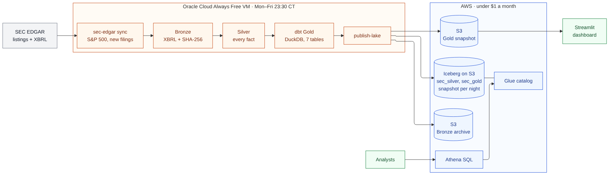
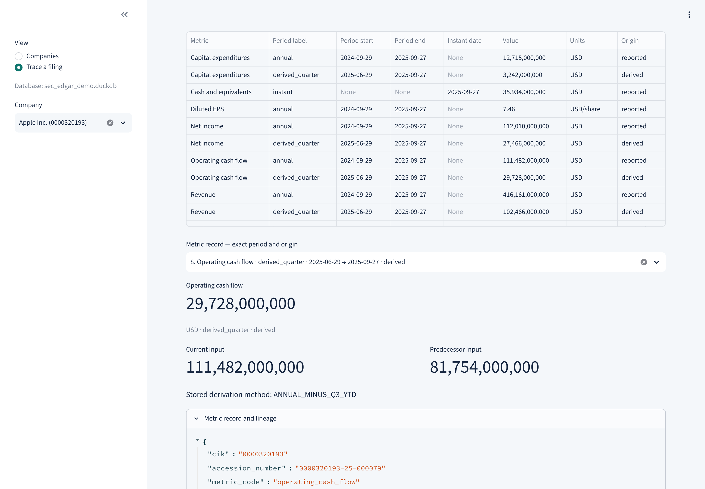
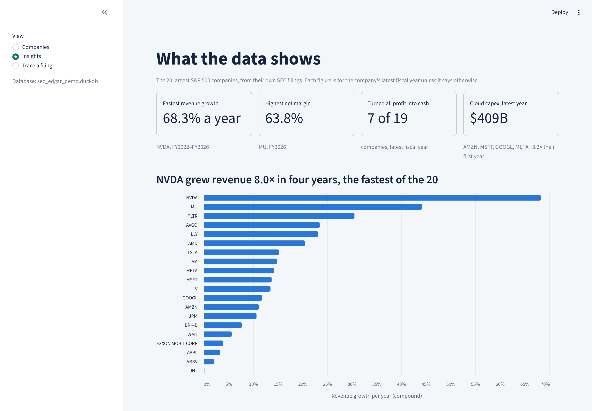

# SEC EDGAR Financial Data Lakehouse

[](https://github.com/dhirajkk91/sec-edgar-financial-data-lakehouse/actions/workflows/ci.yml)


[](https://sec-lakehouse.streamlit.app/)

**A data pipeline that turns raw SEC filings into financial numbers you can trust, keeps the S&P 500 up to date on weeknights, and traces every number back to the exact fact in the filing it came from.**

### [▶ Open the live dashboard](https://sec-lakehouse.streamlit.app/)

Nothing to install. **Companies** compares financials across years, **Insights** answers four questions about them, and **Trace a filing** follows a number back to its source.

**Status:** deployed; the initial S&P 500 backfill is in progress. Until it completes, the live dashboard shows the 20-company snapshot.

---

Public companies report their financials to the SEC in XBRL. The raw data is messier than it looks: one company reports two revenue figures, fourth quarters are almost never reported on their own, facts in the same filing can disagree, and every company's fiscal year ends in a different month. Most projects skip this by starting from an API that has already cleaned the data. I wanted the hard part to be the data engineering, so this one starts from the original filings, makes every cleaning decision explicit and tested, and runs on its own in the cloud.

## Where to look

| If you care about… | Start here |
| --- | --- |
| **Data engineering** | The [cloud architecture](docs/architectures/cloud-lakehouse.md) (Oracle compute, S3 + Iceberg + Glue + Athena, Terraform), the [weeknight sync](docs/architectures/end-to-end-pipeline.md), the [Bronze](docs/architectures/bronze-ingestion.md) and [Silver](docs/architectures/silver-processing.md) guarantees, and [21 design decisions with their trade-offs](docs/decisions/engineering-decisions.md) |
| **Analytics engineering** | The [dbt project](transform/): concept priority, derived quarters and quality issues as tested SQL, explained in the [Gold notes](docs/architectures/gold-financial-metrics.md) |
| **Data analysis** | The [written analysis](docs/analysis/what-the-data-shows.md) with SQL and caveats, the [exploratory notebook](notebooks/exploratory-analysis.ipynb), the [Athena queries](infra/aws/queries/) (window functions, time travel) and the dashboard's Insights view |

## At a glance

| | |
| --- | --- |
| **Scope** | The S&P 500 (500 issuers), original 10-K and 10-Q filings from the last five years, refreshed Monday to Friday nights |
| **Analysis cohort** | 20 largest companies, 400 filings, frozen on October 15, 2026, so the written analysis can be reproduced exactly |
| **Data (cohort)** | 601,103 XBRL facts into 4,310 financial values (3,576 reported, 734 derived), each linked to its source facts; 557 quality issues recorded with a reason instead of a guessed number |
| **Performance** | Full Gold rebuild cut from 34 minutes to 18 seconds; Bronze cut from ~25 MB to ~3.5 MB a filing |
| **Cost** | Free compute on Oracle's free tier; AWS estimated at under $1 a month after my credits run out, with a budget alarm |
| **Testing** | 972 Python tests, 592 dbt nodes, six CI jobs on every change, none of which call the SEC |
| **Stack** | Python · DuckDB · dbt · Apache Iceberg · S3 · Glue · Athena · Terraform · Docker · systemd · Streamlit · GitHub Actions |

## Architecture



Every weeknight at 11:30 p.m. Central, a container on a free Oracle Cloud VM checks each S&P 500 company's SEC listing, processes only the filings it hasn't done through Bronze, Silver and the DuckDB catalog, and builds Gold once with dbt. Then it publishes to the lake on AWS: new raw files to S3, changed Silver filings and all of Gold as **Apache Iceberg** tables in the **Glue** catalog, and a Gold-only snapshot for the dashboard. Analysts query the lake with **Athena**; every night is an Iceberg snapshot, so "what changed since last week?" is one query. During a long backfill it publishes every 25 companies, so the dashboard fills in as it goes.

Compute runs on a free-tier Oracle VM and only storage and SQL run on AWS, where they cost cents at this size ([why](docs/decisions/engineering-decisions.md#18-compute-on-a-free-oracle-vm-the-lake-on-aws)). The job runs in its own container, capped at 1 CPU and 5 GB. The AWS side is all [Terraform](infra/aws/).

| Layer | What it does | What it guarantees |
| --- | --- | --- |
| **Bronze** | Finds each filing through the SEC's own listings and downloads the XBRL files Silver reads | Files are checked (SEC host, expected size, no block page, valid XML) and hashed before they count, and never changed afterwards; every file the SEC lists is recorded, even ones not archived |
| **Silver** | Extracts every numeric XBRL fact into Parquet | Exact decimal values; a broken fact is rejected with a reason, not dropped; a new version goes live only after it is verified |
| **Catalog** | DuckDB over the active Silver versions, plus filing, fiscal-period and company metadata | Every metadata field is tied to the saved SEC response it came from |
| **Gold** | dbt models that select, derive and check eight metrics: revenue, net income, diluted EPS, total assets, total liabilities, cash, operating cash flow and capital expenditures | Conflicting evidence is withheld, never guessed; derived values keep both inputs |
| **Lake** | Bronze archive, Silver and Gold as Iceberg tables on S3, queried with Athena | Incremental: raw files upload once, only changed filings rewrite Silver; each publish is an atomic, queryable snapshot |
| **Dashboard** | Streamlit app over the nightly Gold snapshot | Shows the stored records exactly; checks the snapshot's checksum and falls back to the committed demo |

Gold publishes seven tables: `fct_financial_metrics` (one row per metric, filing and period, with full lineage), `dim_filings`, `metric_quality_issues`, `dim_companies`, `fct_company_financials` (one row per company and fiscal period, with margins, free cash flow and growth), and two summaries, `company_insights` and `company_metric_coverage`.

## The problems it solves

These are real cases from the data. The rule behind each one is covered by dbt unit tests and data tests.

- **One number, two answers.** Walmart's FY2026 10-K reports total revenue of $713.2B and contract revenue of $706.4B. The pipeline picks by a documented priority order, so total revenue wins, and it records a warning that the other figure differs instead of hiding it.
- **Quarters nobody reported.** Companies report Q4 only inside the full-year total. Apple's FY2025 Q4 operating cash flow, $29.7B, is derived as the annual $111.5B minus the Q3 year-to-date $81.8B, and both source facts stay attached to the result.
- **Facts that disagree.** When a company's own facts for the same item conflict, as with Walmart's FY2026 cash balance, the value is withheld and logged as an error. It is never averaged or guessed.
- **Different calendars.** Apple's fiscal year ends in September and Microsoft's in June. Fiscal periods come from each filing's own metadata, not from the calendar.

## Trace any number back to its source

Every value in Gold carries the IDs of the exact facts it came from, and each fact carries the checksum of the file it was read from. In the dashboard, **Trace a filing** shows a derived value next to both of its inputs and the stored derivation method.



The [Gold notes](docs/architectures/gold-financial-metrics.md#trace-one-q4-value-back-to-the-filing) follow the Apple example through every layer, down to the two XML files and their SHA-256 hashes.

## What the data shows

From the frozen 20-company cohort. The [exploratory notebook](notebooks/exploratory-analysis.ipynb) checks missing values, distributions, outliers, trends and seasonality first; the [written analysis](docs/analysis/what-the-data-shows.md) has the SQL, results and caveats for each finding.

- **Growth.** NVIDIA grew revenue 8.0× in four years, from $26.9B to $215.9B, or 68.3% a year. The median of the 20 companies is 13.6%.
- **Profitability.** Micron kept 64 cents of every revenue dollar as profit in FY2026, up from 23 cents a year earlier, at the top of a memory price cycle.
- **Cash.** Only 7 of 19 companies turned all of their profit into free cash. Amazon turned just 10%, because capex took 94% of its operating cash flow.
- **Capex.** The four cloud companies' capital spending rose 3.2× to $409B a year, almost all of it from FY2024 on.
- **The data itself.** Five companies, including Walmart and Amazon, never report a consolidated total-liabilities figure. The notebook found this before any chart was drawn, which is why the analysis uses income and cash-flow measures.



Everything on the Insights view is computed from Gold, so it stays correct as new filings come in.

## Engineering highlights

- **Raw source of truth, kept small.** Bronze keeps the SEC's original bytes for the files Silver reads, plus a manifest; it never overwrites a published filing. Dropping the HTML, images and duplicate submission text cut it from 25 MB to 3.5 MB a filing. ([decision 17](docs/decisions/engineering-decisions.md#17-bronze-archives-what-silver-reads-not-the-whole-filing))
- **Nothing silently disappears.** Silver keeps every numeric fact, including the ones it rejects, as exact decimals. ([decision 4](docs/decisions/engineering-decisions.md#4-silver-keeps-every-fact-with-exact-values-and-explicit-rejections))
- **Runs that pick up where they left off.** The sync saves state after every company; a failed filing stays pending and is retried the next night, and an SEC block page stops the run instead of retrying around it. ([decision 20](docs/decisions/engineering-decisions.md#20-a-nightly-per-company-check-instead-of-a-watermark), [decision 11](docs/decisions/engineering-decisions.md#11-being-a-polite-sec-client))
- **An open table format with history.** Silver and Gold are Iceberg tables written from Python, so Athena (or Spark, Trino, DuckDB) can read them and every night is a snapshot. The same code runs against a local catalog in tests. ([decision 19](docs/decisions/engineering-decisions.md#19-iceberg-tables-written-from-python-gold-still-built-in-duckdb))
- **Business rules in dbt, with tests.** Concept priority, period rules and quarter derivation are SQL models with data tests and unit tests. Priority picks the concept, never the value. ([decision 15](docs/decisions/engineering-decisions.md#15-priority-picks-the-concept-never-the-value))
- **Two kinds of status.** "Did the pipeline run?" and "Is the data good?" are tracked separately, so a successful run can still report incomplete financials. ([decision 9](docs/decisions/engineering-decisions.md#9-did-the-pipeline-run-and-is-the-data-good-are-separate-statuses))
- **Measured performance work.** Storing Gold as tables instead of views took the full build from 34 minutes to 18 seconds and fixed a dashboard out-of-memory error. ([decision 14](docs/decisions/engineering-decisions.md#14-gold-is-stored-as-tables-staging-stays-as-views))
- **Safe to publish.** Before Gold leaves the machine, an export rewrites local paths and refuses anything that looks like a home folder or an email address; the dashboard's AWS key can read exactly two objects. ([decision 16](docs/decisions/engineering-decisions.md#16-the-live-demo-reads-a-gold-only-copy-not-the-pipelines-database))

The [engineering decisions](docs/decisions/engineering-decisions.md) also list the bugs that changed the design, such as the broken fact that vanished instead of being rejected (lesson: count before you filter) and the demo export that would have published my folder names.

## First cloud run

Before the backfill, one company was run through the deployed pipeline at 1 CPU ([details](docs/architectures/cloud-lakehouse.md#first-run)):

| Checkpoint | Result |
| --- | ---: |
| Apple filings synced | 23 of 23 (5 10-K, 18 10-Q), none failed |
| Sync and Gold build | 219 seconds |
| Published to the lake | 23 Bronze filings, 31,198 Silver rows, 325 Gold rows |
| Read back with Athena | the same 5 + 18 filings, from Iceberg on S3 |

## Results from the 20-company run

The [cohort](config/cohort-sp500-top20-2026-10-15.json) is the 20 largest S&P 500 issuers by market cap on October 15, 2026, with their original 10-K and 10-Q filings for five completed fiscal years, chosen before any download.

| Checkpoint | Result |
| --- | ---: |
| Filings planned and ingested | 400 of 400 (341 new, 59 safely reused, none failed) |
| XBRL facts in the catalog | 601,103 accepted, 0 rejected |
| Financial values in Gold | 4,310 (3,576 reported, 734 derived) |
| Filing quality | 238 complete, 162 partial |
| Quality issues | 240 errors, 317 warnings |
| Annual revenue coverage | 100 of 100 company-years |
| dbt build | All 592 nodes passed |

A partial filing still has useful data: Gold withheld one or more of its metrics and kept the rest, for example capital expenditures for banks and EPS for companies with several share classes. Three JPMorgan filings are flagged because the SEC history files that listed them didn't match the saved plan exactly; the filings themselves landed. The [full cohort report](docs/validation/cohort.md) has every number.

## Run it

**1. In the browser:** open the [live dashboard](https://sec-lakehouse.streamlit.app/).

**2. With Docker:** the same dashboard over the committed demo database.

```sh
docker build --tag sec-edgar-dashboard .
docker run --rm --publish 8501:8501 sec-edgar-dashboard   # then open http://localhost:8501
```

**3. Locally:** with Python 3.14 and [uv](https://docs.astral.sh/uv/getting-started/installation/):

```sh
make install          # locked dependencies: pipeline, dbt, dashboard, notebook, lake, checks
make check            # lint, type-check and run the tests
make demo-dashboard   # the dashboard on the committed demo database
make eda              # re-run the exploratory notebook
```

To pull real filings, set a `SEC_USER_AGENT` with your own contact details (the SEC requires it) and sync one company, then publish it to a local Iceberg lake, no AWS needed:

```sh
export SEC_USER_AGENT="Your App Name your.email@example.com"
uv run sec-edgar sync --universe config/universe-sp500.json --data-root data/demo \
  --ciks 0000320193 --since 2025-01-01
make dashboard DATABASE=data/demo/query/sec_edgar.duckdb
make lake-local DATA_ROOT=data/demo
```

**4. In the cloud:** the [deploy guide](docs/guides/deploying.md). The [pipeline guide](docs/guides/running-the-pipeline.md) covers running, inspecting and recovering by hand.

## Testing and CI

Every pull request and push to `main` runs six jobs. None of them call the SEC: they use small synthetic filings, and the test suite blocks external connections.

| Job | What it proves |
| --- | --- |
| **Python checks** (Linux and macOS) | Ruff, mypy and all 972 tests pass, including the notebook run and a publish to a local Iceberg catalog |
| **Offline dbt** | A synthetic company goes from XML files through Bronze, Silver and the catalog to a full dbt build, and the exact Gold values, warnings and lineage match |
| **Built wheel** | The package installs and works without dbt, Streamlit or the lake packages, outside the checkout, and every `sec-edgar` command starts |
| **Hosted demo** (Python 3.12) | The live app's entry point opens all three views with only its pinned packages, the committed demo matches its checksum, and a downloaded snapshot is checked against its manifest |
| **Dashboard image** | The Docker image builds, starts and passes its health check |
| **Pipeline image** | The weeknight job's image builds, its commands and the Iceberg and AWS clients load, and it refuses to start without a lake configured |

`make ci` runs the Python, dbt and wheel checks locally. The [CI notes](docs/validation/ci.md) explain what each check is designed to catch.

## Project structure

| Path | Responsibility |
| --- | --- |
| `src/sec_edgar_lakehouse/bronze/` | SEC discovery, paced requests, what gets archived, validation and publication |
| `src/sec_edgar_lakehouse/silver/` | XBRL extraction, exact values, rejected facts, versioned Parquet and active pointers |
| `src/sec_edgar_lakehouse/catalog/`, `metadata/` | DuckDB over active Silver, plus filing, fiscal and company metadata tied to source evidence |
| `src/sec_edgar_lakehouse/pipeline/` | The weeknight `sync`, the frozen `cohort`, company runs and the Gold build |
| `src/sec_edgar_lakehouse/lake/` | `publish-lake`: Bronze to S3, Silver and Gold to Iceberg, the dashboard snapshot |
| `transform/` | dbt project: concept mappings, selection and derivation SQL, marts, data tests and unit tests |
| `src/sec_edgar_lakehouse/dashboard/` | Read-only Gold readers, the three dashboard views and the Gold-only export |
| `infra/aws/` | Terraform for S3, Glue, Athena, IAM and the budget, plus the saved Athena queries |
| `deploy/pipeline/` | The weeknight job's image, script, systemd timer and installer for the Oracle VM |
| `deploy/streamlit_app.py`, `demo/`, `Dockerfile` | The hosted dashboard's entry point and pins, the demo database and the dashboard image |
| `config/` | The S&P 500 universe and the frozen 20-company cohort |
| `notebooks/`, `docs/analysis/` | The exploratory analysis and the written findings |
| `tests/`, `scripts/ci/`, `.github/workflows/` | Tests, synthetic end-to-end validation and CI |

## Limits and what's next

It covers the US-GAAP concepts mapped for eight metrics, not every company-specific extension, and it does not convert currencies. Amendments (10-K/A, 10-Q/A) are left out until Gold has a policy for them. Gold is built in DuckDB on the VM and copied to Iceberg each night, so Athena reads last night's Gold, not a live build.

What I would do next:

- **Measure the Gold build at S&P 500 scale** and make the fact table incremental only if it needs to be.
- **Handle EPS for companies with several share classes,** such as Berkshire and Visa, by choosing a documented class.
- **Decide an amendment policy:** when a corrected filing should replace the original in trends.
- **Alert on a failed night,** beyond the budget email, and publish a public "last run" status.

## Documentation

- **How it works:** [cloud lakehouse](docs/architectures/cloud-lakehouse.md) · [weeknight pipeline](docs/architectures/end-to-end-pipeline.md) · [Bronze](docs/architectures/bronze-ingestion.md) · [Silver](docs/architectures/silver-processing.md) · [DuckDB catalog](docs/architectures/duckdb-query-catalog.md) · [company runs](docs/architectures/company-pipeline-orchestration.md) · [cohort backfill](docs/architectures/cohort-backfill.md) · [Gold](docs/architectures/gold-financial-metrics.md) · [dashboard](docs/architectures/dashboard.md)
- **What it shows:** [exploratory notebook](notebooks/exploratory-analysis.ipynb) · [analysis of the 20 companies](docs/analysis/what-the-data-shows.md) · [Athena queries](infra/aws/queries/)
- **Why it works this way:** [engineering decisions and bugs](docs/decisions/engineering-decisions.md)
- **Evidence:** [20-company cohort](docs/validation/cohort.md) · [Apple and Microsoft acceptance run](docs/validation/multi-company-acceptance.md) · [CI and clean installs](docs/validation/ci.md)
- **Operating it:** [deploy guide](docs/guides/deploying.md) · [pipeline guide](docs/guides/running-the-pipeline.md)

## Author

Built by Dhiraj Karki · [GitHub](https://github.com/dhirajkk91) · [LinkedIn](https://www.linkedin.com/in/dhiraj-karki-331526328/)

## License

[MIT](LICENSE). The SEC filings themselves are public data from [SEC EDGAR](https://www.sec.gov/edgar).
