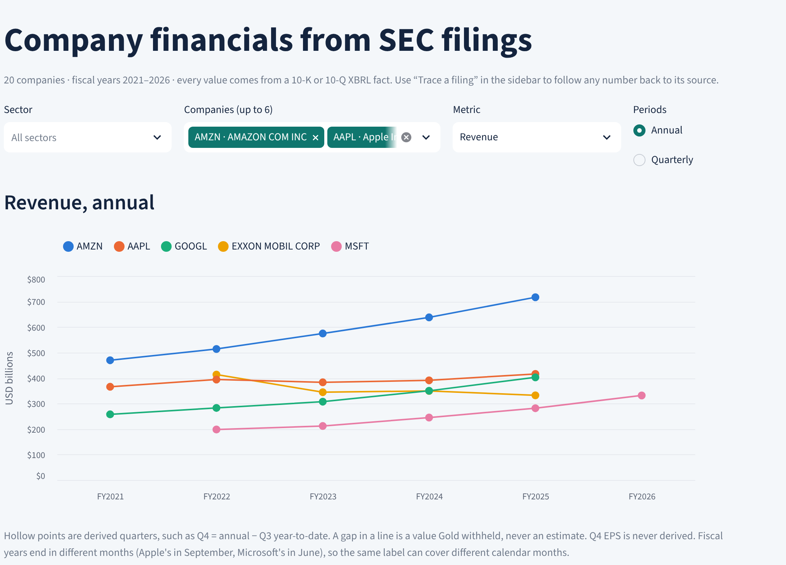
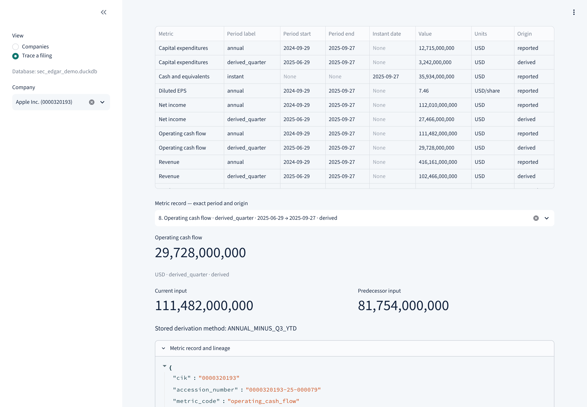

# SEC EDGAR Financial Data Lakehouse

[](https://github.com/dhirajkk91/sec-edgar-financial-data-lakehouse/actions/workflows/ci.yml)


[](https://sec-lakehouse.streamlit.app/)

**A data pipeline that turns raw SEC filings into financial numbers you can trust, and traces every number back to the exact fact in the filing it came from.**

### [▶ Open the live dashboard](https://sec-lakehouse.streamlit.app/)

Nothing to install. It opens on 20 companies' financials, and the **Trace a filing** view opens on a real example of a number being traced to its source.

---

Public companies report their financials to the SEC in XBRL, a machine-readable format. The raw data is messier than it looks: one company reports two different revenue figures, fourth quarters are almost never reported on their own, facts in the same filing can disagree, and every company's fiscal year ends in a different month. Most projects skip this by starting from an API that has already cleaned the data. I wanted a project where the hard part is the data engineering, not the download, so this one starts from the original filings and makes every cleaning decision explicit, tested and traceable.

| At a glance | |
| --- | --- |
| **Scope** | The 20 largest S&P 500 companies by market cap, 400 annual and quarterly filings (10-K, 10-Q), five fiscal years each |
| **Data** | 601,103 XBRL facts extracted into 4,310 financial values (3,576 reported, 734 derived), each linked to its source facts |
| **Data quality** | 557 issues recorded with a reason instead of a guessed number; every filing gets a quality status |
| **Performance** | Full Gold rebuild cut from 34 minutes to 18 seconds |
| **Testing** | 1,341 Python tests, 571 dbt nodes (models, seed and tests), five CI jobs on every change |
| **Stack** | Python · Parquet · DuckDB · dbt · Streamlit · Docker · GitHub Actions |



## The problems it solves

These are real cases from the data. The rule behind each one is covered by dbt unit tests and data tests.

- **One number, two answers.** Walmart's FY2026 10-K reports total revenue of $713.2B and contract revenue of $706.4B. The pipeline picks by a documented priority order, so total revenue wins, and it records a warning that the other figure differs instead of hiding it.
- **Quarters nobody reported.** Companies report Q4 only inside the full-year total. Apple's FY2025 Q4 operating cash flow, $29.7B, is derived as the annual $111.5B minus the Q3 year-to-date $81.8B, and both source facts stay attached to the result.
- **Facts that disagree.** When a company's own facts for the same item conflict, as with Walmart's FY2026 cash balance, the value is withheld and logged as an error. It is never averaged or guessed.
- **Different calendars.** Apple's fiscal year ends in September and Microsoft's in June. Fiscal periods come from each filing's own metadata, not from the calendar.

## How it works

```text
SEC EDGAR (submissions, filing indexes, XBRL files)
        │  paced, identified requests
        ▼
Bronze   original files, checked and never modified
        ▼
Silver   every numeric XBRL fact, exact decimals, versioned Parquet
        ▼
DuckDB   catalog over active Silver + filing, fiscal and company metadata
        ▼
Gold     dbt selects one value per metric and period, derives missing quarters,
         and records every quality issue
        ▼
Streamlit dashboard (read-only): company comparison + filing explorer
```

| Layer | What it does | What it guarantees |
| --- | --- | --- |
| **Bronze** | Finds each filing through the SEC's own listings and downloads the source files | Files are checked (SEC host, expected size, no block page, valid structure) and hashed before they count, and never changed afterwards |
| **Silver** | Extracts every numeric XBRL fact into Parquet | Exact decimal values; a broken fact is rejected with a reason, not dropped; a new version goes live only after it is verified |
| **Catalog** | DuckDB views over the active Silver versions, plus filing, fiscal-period and company metadata | Every metadata field is tied to the saved SEC response it came from |
| **Gold** | dbt models that select, derive and check eight metrics: revenue, net income, diluted EPS, total assets, total liabilities, cash, operating cash flow and capital expenditures | Conflicting evidence is withheld, never guessed; derived values keep both inputs |
| **Dashboard** | Streamlit app with a company comparison and a filing explorer | Shows the stored records exactly; never recalculates a number |

Gold publishes five tables: `fct_financial_metrics` (one row per metric, filing and period, with full lineage), `dim_filings` (one quality summary per filing), `metric_quality_issues`, `dim_companies` (name, tickers, SEC industry and sector, all from the SEC's own data) and `fct_company_financials` (one row per company and fiscal period, with margins, free cash flow and growth side by side).

## Trace any number back to its source

Every value in Gold carries the IDs of the exact facts it came from, and each fact carries the checksum of the file it was read from. In the dashboard, **Trace a filing** shows a derived value next to both of its inputs and the stored derivation method, and the full record lists the source IDs.



The [Gold notes](docs/architectures/gold-financial-metrics.md#trace-one-q4-value-back-to-the-filing) follow the Apple example through every layer, down to the two XML files and their SHA-256 hashes.

## Engineering highlights

- **Raw source of truth.** Bronze keeps the SEC's original bytes and a manifest for each filing. Files are staged, checked, then published once; an existing filing is never overwritten. ([decision 3](docs/decisions/engineering-decisions.md#3-bronze-is-write-once-and-checked-before-it-counts))
- **Nothing silently disappears.** Silver keeps every numeric fact, including the ones it rejects, and stores values as exact decimals, not floats. ([decision 4](docs/decisions/engineering-decisions.md#4-silver-keeps-every-fact-with-exact-values-and-explicit-rejections))
- **Safe reprocessing.** Silver is versioned by source checksum and parser version, and an active pointer switches only after the new version is verified. Reruns skip verified work, and an interrupted 20-company run resumes where it stopped. ([decision 5](docs/decisions/engineering-decisions.md#5-silver-is-versioned-and-an-active-pointer-decides-what-readers-see))
- **Separate identities.** Company, filing, source file, fact, Silver version and run each have their own key, which is what makes lineage and reruns inspectable. ([decision 2](docs/decisions/engineering-decisions.md#2-separate-keys-for-company-filing-fact-and-run))
- **Business rules in dbt, with tests.** Concept priority, period rules and quarter derivation are SQL models with data tests and unit tests. Priority picks the concept, never the value. ([decision 15](docs/decisions/engineering-decisions.md#15-priority-picks-the-concept-never-the-value))
- **Two kinds of status.** "Did the pipeline run?" and "Is the data good?" are tracked separately, so a successful run can still report incomplete financials. ([decision 9](docs/decisions/engineering-decisions.md#9-did-the-pipeline-run-and-is-the-data-good-are-separate-statuses))
- **A polite SEC client.** Requests are paced, identified with a contact User-Agent and stop on a block page or a long `Retry-After` instead of retrying around it. ([decision 11](docs/decisions/engineering-decisions.md#11-being-a-polite-sec-client))
- **Measured performance work.** Storing Gold as tables instead of views took the full build from 34 minutes to 18 seconds and fixed a dashboard out-of-memory error. ([decision 14](docs/decisions/engineering-decisions.md#14-gold-is-stored-as-tables-staging-stays-as-views))
- **A safe public demo.** The hosted app reads a 3 MB copy of the Gold tables. The export rewrites local paths and refuses to publish anything that looks like a home folder or an email address. ([decision 16](docs/decisions/engineering-decisions.md#16-the-live-demo-reads-a-gold-only-copy-not-the-pipelines-database))

## Results from the 20-company run

The [cohort](config/cohort-sp500-top20-2026-10-15.json) is frozen: the 20 largest S&P 500 issuers by market cap on October 15, 2026, with their original 10-K and 10-Q filings for five completed fiscal years, chosen before any download.

| Checkpoint | Result |
| --- | ---: |
| Filings planned and ingested | 400 of 400 (341 new, 59 safely reused, none failed) |
| Verified Bronze publications and active Silver versions | 400 and 400 |
| XBRL facts in the catalog | 601,103 accepted, 0 rejected |
| Financial values in Gold | 4,310 (3,576 reported, 734 derived) |
| Filing quality | 238 complete, 162 partial |
| Quality issues | 240 errors, 317 warnings |
| Annual revenue coverage | 100 of 100 company-years |
| dbt build | All 571 nodes passed |

A partial filing still has useful data: Gold withheld one or more of its metrics and kept the rest. Some gaps are deliberate, such as capital expenditures for banks and EPS for companies with several share classes. The run's own status is also partial: three JPMorgan filings landed, but the SEC history files that listed them didn't match the saved plan exactly, so their planning-to-processing trace is flagged for review. The [full cohort report](docs/validation/cohort.md) has every number, including the before and after of each improvement.

## Bugs that shaped the design

Some of the most useful work came from things that broke. A few of them:

- **Palantir's XBRL file "wasn't there."** My check only accepted one exact label for the instance document, and Palantir's 2021 filing used another. The fix accepts both labels and never touches the original bytes.
- **A broken fact vanished instead of being rejected.** A fact without a unit was skipped before the rejection logic ran, so a run reported success with zero rejections. Now it is counted and rejected. Lesson: count before you filter.
- **The dashboard ran out of memory** on the full cohort, because every Gold model was a view that recomputed everything on each page load. That led to storing Gold as tables, and to the 34-minute → 18-second build.
- **The demo export would have published my folder names,** because Gold stored absolute file paths. The export now rewrites them and checks every text column before it finishes.

The [engineering decisions](docs/decisions/engineering-decisions.md#bugs-that-changed-the-design) list all of them, along with 16 design decisions and their trade-offs.

## Run it

**1. In the browser:** open the [live dashboard](https://sec-lakehouse.streamlit.app/). Nothing to install.

**2. With Docker:** this serves the same dashboard over the committed demo database.

```sh
docker build --tag sec-edgar-dashboard .
docker run --rm --publish 8501:8501 sec-edgar-dashboard
```

Then open http://localhost:8501.

**3. Locally:** with Python 3.14 and [uv](https://docs.astral.sh/uv/getting-started/installation/):

```sh
make install          # locked dependencies for the pipeline, dbt, dashboard and checks
make check            # lint, type-check and run the 1,341 tests
make demo-dashboard   # open the dashboard on the committed demo database
uv run sec-edgar --help
```

Running the pipeline downloads filings from the SEC, which requires a `SEC_USER_AGENT` with your own contact details. This runs one company, Apple, through every layer:

```sh
export SEC_USER_AGENT="Your App Name your.email@example.com"
mkdir -p data/demo/runs/dbt
uv run sec-edgar pipeline \
  --cik 0000320193 --forms 10-K 10-Q \
  --filed-on-or-after 2025-01-01 --filed-on-or-before 2025-12-31 --limit 2 \
  --bronze-directory data/demo/bronze/sec/filings \
  --silver-directory data/demo/silver/sec/filings \
  --database data/demo/query/sec_edgar.duckdb \
  --run-directory data/demo/runs/company \
  --end-to-end-run-directory data/demo/runs/end-to-end \
  --dbt-project-directory transform --dbt-profiles-directory transform \
  --dbt-artifact-directory data/demo/runs/dbt/apple-first
make dashboard DATABASE=data/demo/query/sec_edgar.duckdb
```

The [pipeline guide](docs/guides/running-the-pipeline.md) covers the 20-company cohort (`sec-edgar cohort plan | execute | resume`), what each output folder holds, SQL to query and trace Gold, how to read each quality issue, and what to do when a run stops partway.

## Testing and CI

Every pull request and push to `main` runs five jobs. None of them call the SEC: they use small synthetic filings, and the test suite blocks external connections.

| Job | What it proves |
| --- | --- |
| **Python checks** (Linux and macOS) | Ruff, mypy and all 1,341 tests pass |
| **Offline dbt** | A synthetic company goes from XML files through Bronze, Silver and the catalog to a full dbt build, and the exact Gold values, warnings and lineage match |
| **Built wheel** | The package installs and works without dbt or Streamlit, outside the checkout, and every `sec-edgar` command starts |
| **Hosted demo** (Python 3.12) | The live app's entry point opens both views with only its pinned packages, and the committed demo matches its checksum |
| **Dashboard image** | The Docker image builds, starts and passes its health check |

`make ci` runs the same Python, dbt and wheel checks locally. The [CI notes](docs/validation/ci.md) explain what each check is designed to catch.

## Project structure

| Path | Responsibility |
| --- | --- |
| `src/sec_edgar_lakehouse/bronze/` | SEC discovery, paced requests, source validation and filing publication |
| `src/sec_edgar_lakehouse/silver/` | XBRL extraction, exact values, rejected facts, versioned Parquet and active pointers |
| `src/sec_edgar_lakehouse/catalog/`, `metadata/` | DuckDB views over active Silver, plus filing, fiscal and company metadata tied to source evidence |
| `src/sec_edgar_lakehouse/pipeline/` | Company and cohort runs, stage gates, dbt builds and run summaries |
| `transform/` | dbt project: concept mappings, selection and derivation SQL, marts, data tests and unit tests |
| `src/sec_edgar_lakehouse/dashboard/` | Read-only Gold readers, the two dashboard views, a terminal inspector and the demo export |
| `src/sec_edgar_lakehouse/cli.py`, `Makefile` | The `sec-edgar` command and shortcuts for everyday tasks |
| `config/` | The frozen manifest of the 20-company cohort |
| `dashboard_app.py`, `duckdb_startup.py`, `.streamlit/` | Local launchers for the dashboard and DuckDB's SQL UI, and the dashboard theme |
| `deploy/`, `demo/`, `Dockerfile` | The hosted app's entry point and pins, the demo database and the dashboard image |
| `tests/`, `scripts/ci/`, `.github/workflows/` | Tests, synthetic end-to-end validation and CI |

## Limits and what's next

This is a local, single-machine pipeline, built for one writer at a time. It covers the US-GAAP concepts mapped for eight metrics, not every company-specific extension, and it does not convert currencies. The live demo is a snapshot of Gold, refreshed by re-exporting after a rebuild, not a running pipeline.

What I would do next:

- **Scale past 20 companies** by making the fact table incremental, so a new filing doesn't rebuild every Gold table.
- **Move to cloud storage and a scheduler,** replacing the active-pointer files with an open table format such as Iceberg and running the cohort on a schedule.
- **Make the database portable** by not storing absolute Parquet paths in the catalog views.
- **Handle EPS for companies with several share classes,** such as Berkshire and Visa, by choosing a documented class.
- **Decide an amendment policy:** when a corrected filing (10-K/A) should replace the original in trends.
- **Resolve the three flagged JPMorgan traces** so the cohort can be marked complete.

## Documentation

- **How it works:** [end-to-end pipeline](docs/architectures/end-to-end-pipeline.md) · [Bronze](docs/architectures/bronze-ingestion.md) · [Silver](docs/architectures/silver-processing.md) · [DuckDB catalog](docs/architectures/duckdb-query-catalog.md) · [company runs](docs/architectures/company-pipeline-orchestration.md) · [cohort backfill](docs/architectures/cohort-backfill.md) · [Gold](docs/architectures/gold-financial-metrics.md) · [dashboard, hosted demo and Docker](docs/architectures/dashboard.md)
- **Why it works this way:** [engineering decisions and bugs](docs/decisions/engineering-decisions.md)
- **Evidence:** [20-company cohort](docs/validation/cohort.md) · [Apple and Microsoft acceptance run](docs/validation/multi-company-acceptance.md) · [CI and clean installs](docs/validation/ci.md)
- **Operating it:** [pipeline guide](docs/guides/running-the-pipeline.md)

## Author

Built by Dhiraj Karki · [GitHub](https://github.com/dhirajkk91) · [LinkedIn](https://www.linkedin.com/in/dhiraj-karki-331526328/)

## License

[MIT](LICENSE). The SEC filings themselves are public data from [SEC EDGAR](https://www.sec.gov/edgar).
