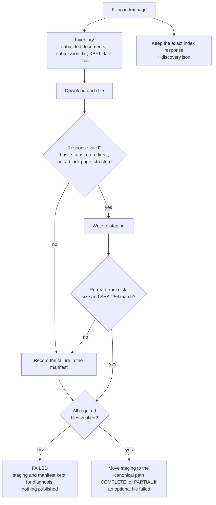
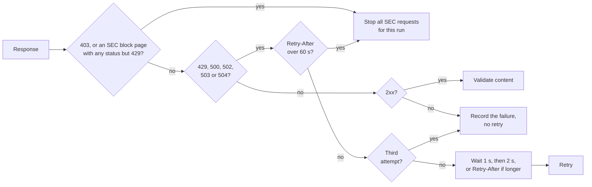

# Bronze: ingesting SEC filings

## Purpose

Bronze downloads a filing's source files from SEC EDGAR and keeps them exactly as received, together with the evidence of how they were obtained. Nothing here interprets a financial value. Silver reads only what Bronze has verified and published, so every later number can be traced back to these bytes.

In the [20-company cohort](../validation/cohort.md), Bronze published 400 filings, each with a verified manifest.

## Goals and non-goals

Goals:

- Keep the original bytes of every required file, with size and SHA-256 recorded and rechecked after writing.
- Never expose a half-downloaded or unverified filing as published.
- Never overwrite a published filing; reuse it only after verifying it again.
- Be a polite SEC client: identified, paced, and quick to stop when the SEC says so.

Non-goals:

- Choosing financial facts or settling disagreements between filings (Silver and Gold do that).
- Guessing a file the SEC index doesn't list, or substituting another filing for a missing one.
- Concurrent downloads.

## Identity

A filing is identified by the issuer's CIK, normalized to 10 digits, and its accession number. The accession's prefix can belong to a filing agent rather than the issuer, so it is never used as the CIK. An amendment has its own accession and is a separate filing.

## Design



1. **Discover.** The ingester reads the filing's SEC index page once and saves that exact response with `discovery.json`. The file inventory and the saved evidence come from the same response; fetching the index again could give a list that doesn't match the saved bytes. File names come from the SEC inventory and are checked as safe local names. A missing primary document is never guessed.
2. **Download and validate.** Each file must come from the expected filing on an allowed SEC host, without a redirect, and be non-empty. Validation then depends on the file type: XML must be well formed, the primary HTML needs document markup, and the complete submission text needs SEC submission markers. A checksum alone can't tell an SEC error page from the real document, so content is checked too.
3. **Stage and verify.** Bytes are written to a staging folder on the same filesystem as the destination, then reopened and checked for size and SHA-256. A response that validated in memory hasn't proven what landed on disk. `Content-Length` is compared only when it describes the bytes the client exposes, since compressed transfers report a different length.
4. **Publish.** A verified staging folder is moved into place with one rename, so readers see either the whole filing or nothing. A failure leaves the staging folder and a failed manifest for diagnosis and publishes nothing.

### What is stored

```text
<bronze root>/cik=<CIK>/accession=<accession>/
├── submitted/                 documents the company filed
├── submission-package/        the complete submission .txt
├── sec-derived/               SEC data files, including the XBRL instance
├── metadata/filing-index.html the exact index response
├── metadata/discovery.json
└── manifests/run_id=<run-id>.json
```

The manifest lists every expected file with its outcome, byte count, SHA-256, number of attempts and whether it was required. Separating required from optional files keeps a missing supporting file from looking like an incomplete source archive.

Two readiness checks answer different questions:

- **`source_complete`:** are all required files intact?
- **`parser_ready`:** is there exactly one verified XML file labelled `EXTRACTED XBRL INSTANCE DOCUMENT` (inline XBRL) or `XBRL INSTANCE DOCUMENT` (older filings)? A source-complete filing can still have no usable Silver input.

| Status | Meaning |
| --- | --- |
| `COMPLETE` | Every required and optional file verified and published |
| `PARTIAL` | Required files verified and published; at least one optional data file failed |
| `FAILED` | A required file failed verification or publication; nothing was published |

## Talking to the SEC



- **Identified.** Every request carries the `SEC_USER_AGENT` from the environment, as the SEC's [fair-access policy](https://www.sec.gov/search-filings/edgar-search-assistance/accessing-edgar-data) requires. The value never goes into tracked files.
- **Paced.** One client and one pacer are shared by discovery and every filing in a company run, so starting a new filing can't reset the spacing. Requests start at least 0.5 seconds apart, well under the SEC's limit of 10 per second, and the tool rejects a shorter interval.
- **Bounded retries.** Connect and read timeouts are 10 and 30 seconds. Network errors, timeouts, 429 and selected 5xx responses get at most three attempts. Other HTTP errors and invalid content are recorded, not retried, because asking again won't change them.
- **Stops on a block.** A 403, a recognised SEC block page (including the rate-limit page the SEC sometimes returns with status 200; with a 429, its `Retry-After` is honoured first), or a `Retry-After` over 60 seconds stops every remaining request in the run, even for optional files. Continuing after a block would make it worse. Redirects are never followed.

The cohort runs companies one at a time and waits between them. It adds no outer retry loop around this one.

## Finding older filings

Company discovery normally reads `filings.recent` from the SEC submissions response. Five years of 10-Qs can go past that window for frequent filers, so the cohort planner also follows the older files listed in `filings.files` when needed. Before using a row from an older file, it checks the parallel arrays, row count, accession identity, dates and document path. An identical overlap uses the recent copy; a conflicting overlap stops discovery. The older files carry no top-level CIK, so they are tied to the company by their CIK-specific file name in the verified main response and its SEC URL. Each listing's bytes, URL, retrieval time, size and checksum are saved under `history/` next to `submissions.json`.

The SEC's declared `filingFrom` and `filingTo` range is checked too. Some live files contain rows just outside it; the planner records the disagreement and flags any selected filing it affects, without shifting dates or swapping filings. One JPMorgan filing in the cohort was flagged this way, and two more because they sat in different history files at planning and at processing time. All three were ingested correctly; only their source trace is flagged.

## Failure handling and reruns

- A required-file failure leaves staging and a failed manifest; no canonical filing is created, and the company run moves on to its next filing.
- An optional data-file failure publishes a `PARTIAL` filing; the manifest names the missing file.
- An existing canonical filing is never overwritten. The company run verifies its manifest before reusing it; an unusable existing folder is reported, not replaced.
- Changed SEC bytes under an existing accession are not silently substituted.

One real case shaped these checks: Palantir's FY2021 Q1 filing labelled its XBRL file `XBRL INSTANCE DOCUMENT` rather than the `EXTRACTED` label the check first required, so a valid filing looked unusable. Both exact labels are accepted now, and the source bytes were never touched ([decision 3](../decisions/engineering-decisions.md#3-bronze-is-write-once-and-checked-before-it-counts), [decision 11](../decisions/engineering-decisions.md#11-being-a-polite-sec-client)).

## Code and tests

| Part | Code |
| --- | --- |
| Submissions listing and filing selection | [`company_filings.py`](../../src/sec_edgar_lakehouse/bronze/company_filings.py) |
| Filing index | [`filing_discovery.py`](../../src/sec_edgar_lakehouse/bronze/filing_discovery.py) |
| File classification | [`filing_inventory.py`](../../src/sec_edgar_lakehouse/bronze/filing_inventory.py) |
| Pacing, retries and stop conditions | [`filing_request.py`](../../src/sec_edgar_lakehouse/bronze/filing_request.py) |
| Response validation | [`filing_download.py`](../../src/sec_edgar_lakehouse/bronze/filing_download.py) |
| Staging, verification and publication | [`filing_publication.py`](../../src/sec_edgar_lakehouse/bronze/filing_publication.py), [`filing_storage.py`](../../src/sec_edgar_lakehouse/bronze/filing_storage.py) |
| One filing end to end | [`filing_ingestion.py`](../../src/sec_edgar_lakehouse/bronze/filing_ingestion.py) |

The [Bronze tests](../../tests/bronze/) cover the request policy, index inventory, invalid content, optional-file failures and safe reuse, all without network access. The [Apple and Microsoft run](../validation/multi-company-acceptance.md) ingested four real filings into a shared root, and a Microsoft rerun reused the published files without changing them. [CI](../validation/ci.md) runs the same path with synthetic filings.
