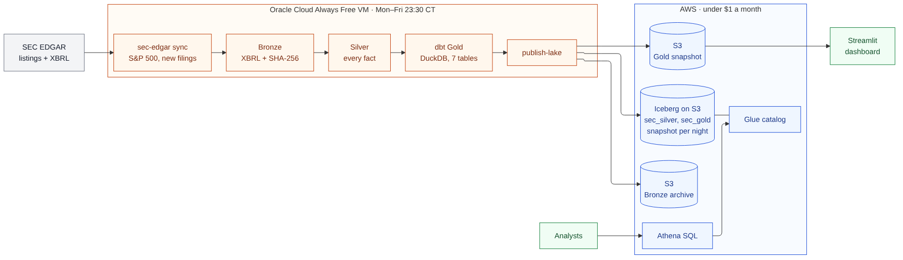

# Cloud lakehouse

## Purpose

The first version of the pipeline ran on a laptop and ended in a DuckDB file. That was fine for 20 companies, but it couldn't keep itself up to date, nobody else could query it, and "lakehouse" was a stretch. This version runs on its own: every weeknight it brings the S&P 500 up to date from the SEC and publishes the result to a lake on AWS.

## What I had to work with

- An Oracle Cloud Always Free VM: an Ampere A1 with 2 OCPUs and 12 GB. Free compute that doesn't expire.
- $200 of AWS credits that expire next year. Whatever I build on AWS has to be close to free after that, or I'll end up turning it off.

So the rule I followed was: anything that bills by the hour runs on the VM, and AWS only gets the parts that bill by use and cost cents at this size.

Oracle's free Arm allowance is 2 OCPUs and 12 GB in total across all instances, and exceeding it disables every Arm instance on a free account. The job therefore runs on an existing VM rather than a second one, isolated in its own container image, data folder (`/var/lib/sec-edgar`), settings file and systemd timer, and capped at 1 CPU and 5 GB with DuckDB limited to 3 GB. It runs only at night.

## Design



- **Oracle VM.** A Docker container on a systemd timer, Monday to Friday at 11:30 p.m. Central. It runs `sec-edgar sync` (new filings through Bronze, Silver and Gold, see the [pipeline notes](end-to-end-pipeline.md)) and then `sec-edgar publish-lake`.
- **S3.** The raw Bronze files, gzipped, and the table files.
- **Iceberg + Glue.** Silver and Gold are Iceberg tables registered in the Glue catalog.
- **Athena.** SQL over those tables, with a 1 GiB cap per query.
- **Streamlit.** The dashboard downloads a Gold snapshot from S3 instead of reading the committed demo.

Everything on AWS is in [Terraform](../../infra/aws/main.tf): 20 resources. I sized it for about 10,000 filings: roughly 3.5 GB of Bronze before compression plus a few GB of Parquet, which by my estimate is under a dollar a month in S3.

## First run

Before the backfill, Apple was run alone through the deployed pipeline ([commands](../guides/deploying.md#3-test-with-one-company)), capped at 1 CPU:

| | |
| --- | --- |
| Filings | 23 (5 10-K, 18 10-Q), none failed |
| Sync and Gold build | 219 seconds |
| Published | 23 Bronze filings, 31,198 Silver rows, 325 Gold rows, the dashboard snapshot |
| Athena | `sec_gold.dim_filings` returned the same 5 + 18 filings straight from S3 |

Backfill duration, lake size and monthly AWS cost will be added once the backfill completes.

I left out Spark, EMR and Airflow on purpose. At about 15 million facts the work fits on one machine, and hosted Airflow alone would cost more per month than the rest of this does in a year.

## Publishing to the lake

[`publish-lake`](../../src/sec_edgar_lakehouse/lake/publish.py) runs after the sync. It tries to only write what changed:

1. **Bronze.** Each new filing folder is gzipped and uploaded once. Bronze never changes after it's published, so a local ledger of uploaded filings is enough. Each object keeps the original file's SHA-256 in its metadata, so Bronze can be rebuilt byte for byte from the lake if the VM dies.
2. **Silver.** `sec_silver.facts`, `fact_dimensions` and `rejected_facts`, partitioned by CIK. Only filings whose active Silver version changed get written: new ones are appended, and a re-parsed filing has its old rows deleted and new ones appended in the same commit.
3. **Gold.** The seven Gold tables go through the same export as the hosted demo first (it rewrites my local paths and refuses to publish anything that looks like a home folder or an email), then each table is overwritten.
4. **Snapshot.** The Gold-only DuckDB file goes to `serving/` for the dashboard, and the night's run summaries go to `runs/`.

Because every publish is an Iceberg snapshot, the lake keeps its own history. For example, [this query](../../infra/aws/queries/05_what_changed_since_last_week.sql) uses `FOR TIMESTAMP AS OF` to list the filings that are new since last week.

With `--lake file:///some/folder` the same code writes to a local folder with a SQLite catalog instead of S3 and Glue. That's how the [tests](../../tests/lake/test_publish.py) check it without an AWS account, and `make lake-local` does it on real data.

```text
s3://<bucket>/sec-edgar/
├── bronze/cik=…/accession=…/…​.gz
├── warehouse/sec_silver/…   and   warehouse/sec_gold/…
├── serving/sec_edgar_gold.duckdb (+ .json)
└── runs/latest-sync.json, latest-publish.json
```

## Security

The bucket is private and encrypted. The VM uses an IAM user that can only touch the lake prefix and the two Glue databases; the dashboard's user can read exactly two objects, the snapshot and its manifest. My `SEC_USER_AGENT` has my email in it, so it only lives in the env file on the VM.

## Trade-offs

- **Gold is built in DuckDB and copied to Iceberg.** I didn't want to rewrite 592 dbt nodes for Athena's SQL dialect and lose the offline CI build. The cost is that Athena reads last night's copy, not the build itself.
- **pyiceberg instead of Spark.** No cluster to run, and it works against a local catalog in tests. It can't compact small files yet, so that's an occasional `OPTIMIZE` in Athena.
- **Checking every company every night** (about 500 requests, four minutes at my pacing) instead of using the SEC's daily index. More requests, but a missed night or a failed filing just gets picked up the next time, without me tracking a watermark.
- **Two clouds.** More setup, and the VM uses a long-lived access key instead of a role. In exchange, compute is free.
- **Weeknights only.** EDGAR only takes filings on business days, so a weekend run would find nothing. A missed weeknight catches up on the next run.

Still to do: an alert when a night fails (right now I'd only notice from the run summary or the budget email), and a public "last run" badge.
