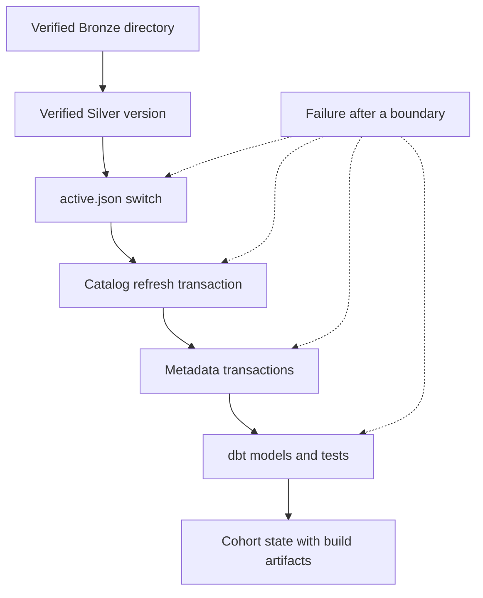

# Cohort backfill: a fixed plan over the company pipeline

The original [company runner](company-pipeline-orchestration-V1.md) answers a bounded request for one CIK. The cohort command adds a frozen, cross-company selection and a checkpoint around that runner. It does not add a second ingester or a second set of financial rules. All companies write to the same Bronze root, Silver root, and DuckDB database, then dbt builds Gold once for the shared catalog.

The tracked [manifest](../../config/cohort-sp500-top20-2026-10-15.json) fixes 20 **distinct issuer CIKs**, their ranking, and a filing cutoff. Tickers are identity checks, not filing keys; Alphabet's two share classes are one issuer. The ranking source reports rounded full market-cap figures, while the IVV holdings source is a membership cross-check with a different weighting method. The [acceptance report](../validation/cohort-V1.md) records the actual selected filings and what landed. A different manifest needs a new plan; a later SEC listing is compared with the frozen one, and a changed source trace stays visible as a coverage issue.

```mermaid
flowchart LR
    M["Tracked issuer manifest"] --> P["plan: SEC submissions + named history files"]
    P --> E["Frozen accessions + saved listing bytes"]
    E --> C["execute/resume: company runner per CIK"]
    C --> B["Verified Bronze + active Silver"]
    B --> D["Shared catalog + filing/fiscal metadata"]
    D --> G["One dbt build after the batch"]
    G --> A["Coverage audit + read-only dashboard"]
```

## Planning and source identity

[`cohort_run.py`](../../src/sec_edgar_lakehouse/pipeline/cohort_run.py) validates the manifest's rank order, 10-digit CIKs, uniqueness, and cutoff before planning. For each issuer it calls [`discover_company_filings`](../../src/sec_edgar_lakehouse/bronze/company_filings.py) with one shared SEC request pacer. It first examines `filings.recent`. If that cannot bound five annual report periods and their quarters, it requests the older CIK-specific files named by the main response's `filings.files`, with a lower date bound. The parser checks their parallel arrays, path names, identities, overlaps, and declared date ranges. Identical recent/history overlaps use the recent row; conflicting fields stop discovery. Older files have no top-level issuer CIK, so the binding is the filename referenced by the verified main response and its canonical URL.

The planner takes the five latest original `10-K` **report dates** at or before the cutoff. For each annual end it looks for original `10-Q` report dates between that end and the preceding annual end. It records gaps or competing annual/quarter candidates; it does not replace a missing filing with the next accession. The saved `cohort-plan.json` contains each accession, exact form, filing date, report date, primary document, source-listing name, annual interval, and any gap. This interval is only a selection candidate. After ingestion, the runner checks the filing's own DEI fiscal year, quarter, and period end against it. Filing date controls the SEC cutoff; report date and DEI control the financial period.

The plan also keeps the original submissions and history-listing bytes under `plan-sources/` with URL, retrieval time, size, and SHA-256. On `execute` or `resume`, `_read_plan` checks the manifest hash, data root, and saved listing files, then returns the plan hash; `resume` also compares that hash with `cohort-state.json`. The company run makes its own SEC discovery request and saves that response under `runs/cik=<CIK>/run_id=<id>/`. The cohort compares its accession's form, dates, document, and source-listing name with the frozen plan. A changed listing trace is a coverage issue even if the bytes ultimately ingested are valid.

The real plan selected 400 accessions: five annual filings and three quarterly filings for each of 20 issuers. Five companies needed older history files. One JPMorgan row disagreed with a history file's declared range, and two planned accessions later appeared in different numbered history files. Their filing identity fields still matched and all three were processed, but the source trace did not. The runner leaves JPMorgan and the cohort `PARTIAL`; the [cohort validation](../validation/cohort-V1.md) lists the affected accessions.

## Execution, checkpoint, and recovery

`_company_attempt` passes the exact planned accessions to [`execute_company_pipeline_run`](../../src/sec_edgar_lakehouse/pipeline/company_run.py). That path verifies or publishes Bronze, verifies or activates Silver, and refreshes the catalog from **all** active pointers in the shared root. [`load_company_run_metadata`](../../src/sec_edgar_lakehouse/metadata/company_metadata.py) then loads SEC filing metadata for active catalog filings and fiscal metadata for the selected filings. Every planned accession gets an outcome, including `NOT_ATTEMPTED` after a terminal SEC stop. A usable filing and complete metadata can coexist with a cohort coverage issue; the state records both.

`cohort-state.json` is replaced through a temporary, synced file after each company and dbt attempt. It stores each company's attempts, run IDs, per-accession outcomes, fiscal focus, catalog and metadata status, coverage issues, company-record path and checksum, and the list of dbt attempts. A local file lock prevents two cohort commands from running at once. Companies run sequentially, with a boundary wait because each company run starts a new pacer; there is no parallel worker or outer SEC retry loop.

`resume` checks the saved plan and state hash. It skips a company with `work_complete=true` only after rehashing that completed company record. It retries unfinished companies through the normal Bronze/Silver checks. `--ranks ... --rerun-complete` explicitly revisits completed companies, for example after a parser correction; it still verifies existing Bronze and Silver before reuse. An existing canonical Bronze filing is not overwritten, matching active Silver versions are skipped, and identical metadata returns `ALREADY_EXISTS`. New attempts get new run IDs. `--build-after-batch` can run dbt again when company work is already complete, using a fresh profile and artifact directory.

`_build` gives dbt the shared database explicitly. Its temporary profile uses one dbt worker, one DuckDB engine thread, a 4GB memory limit, and insertion-order preservation. The final build starts after all 20 companies have usable work, or when a caller explicitly requests a pilot/batch build. The saved build result includes the invocation ID and artifact path. A `COMPLETE` dbt stage means its nodes passed; it does not make a `PARTIAL` coverage issue disappear or convert Gold quality warnings into pipeline failures.

Bronze directory publication and the Silver pointer are separate file operations. Catalog refresh commits its tables and views together, and metadata loads have their own transactions. A dbt failure may leave some Gold relations replaced before a later model or test fails. The state retains that failed attempt and its artifacts; check the build stage before treating Gold as current. Keep other database readers closed while any stage writes. The catalog stores absolute Parquet paths, so moving only the DuckDB file will break the dataset.

## Where to inspect it

| Question | Owner and saved evidence |
| --- | --- |
| Why this issuer and accession? | [Manifest](../../config/cohort-sp500-top20-2026-10-15.json), `cohort-plan.json`, and checksummed `plan-sources/`; selection and source checks in [`cohort_run.py`](../../src/sec_edgar_lakehouse/pipeline/cohort_run.py) and [`company_filings.py`](../../src/sec_edgar_lakehouse/bronze/company_filings.py). |
| What happened to a filing? | `cohort-state.json` and `runs/cik=<CIK>/run_id=<id>/run.json`; [company runner](company-pipeline-orchestration-V1.md), [Bronze](bronze-ingestion-V1.md), and [Silver](silver-processing-V1.md) own the stage evidence. |
| Which files are queryable? | `silver/cik=<CIK>/accession=<id>/active.json` and [`silver_catalog.py`](../../src/sec_edgar_lakehouse/catalog/silver_catalog.py); the [catalog note](duckdb-query-catalog-V1.md) explains verification and the transaction. |
| Why is a fiscal period or metric missing? | `silver.filing_fiscal_metadata`, the [Gold models](gold-financial-metrics-V1.md), `gold.metric_quality_issues`, and [cohort quality audit](../validation/cohort-V1.md). |
| Did the batch build finish? | Latest `cohort-state.json.dbt_attempts` entry, its `target/run_results.json` and `manifest.json`, plus [`dbt_build.py`](../../src/sec_edgar_lakehouse/pipeline/dbt_build.py). |

[`tests/pipeline/test_cohort_run.py`](../../tests/pipeline/test_cohort_run.py) covers planning, checkpoints, resume, and build gates with local fixtures. The [offline CI script](../../scripts/ci/validate_offline_dbt.py) checks the shared data handoff with fictional filings. The [400-filing audit](../validation/cohort-V1.md) checks saved run records, source ownership, exact derived values, and Gold counts against real selected filings. V1 has no scheduler or broader writer coordination, and Gold only covers its mapped concepts.
