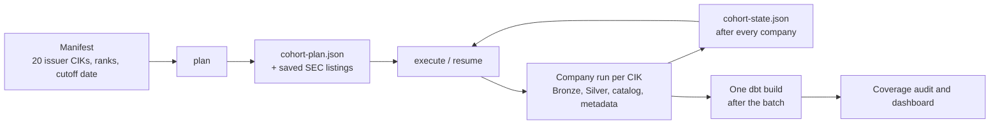
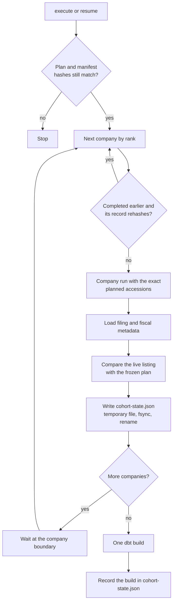

# Cohort backfill: 20 companies from a frozen plan

## Purpose

The [company run](company-pipeline-orchestration.md) handles one company and one bounded request. The cohort backfill runs a fixed set of 20 companies over five fiscal years each, and makes that run repeatable, resumable and auditable. It adds a frozen plan and a checkpoint around the existing company run; it doesn't add a second ingester or a second set of financial rules. All companies share one Bronze root, one Silver root and one DuckDB database, and dbt builds Gold once for all of them.

The real run planned and landed 400 filings. Its results are in the [cohort report](../validation/cohort.md).

## Goals and non-goals

Goals:

- Decide which filings to process **before** downloading anything, and save the evidence for that decision.
- Survive interruption: a stopped run resumes where it left off without redoing verified work.
- Record, per company and per filing, exactly what happened.
- Keep planning honest: a planned filing is never swapped for a different one, and a changed SEC listing is flagged rather than ignored.

Non-goals:

- A scheduler or parallel workers. Companies run one at a time.
- Choosing a different cohort on the fly; a different company list needs a new manifest and a new plan.

## Design

### The manifest

The tracked [manifest](../../config/cohort-sp500-top20-2026-10-15.json) fixes 20 **distinct issuer CIKs**, their rank and a filing cutoff date: the 20 largest S&P 500 issuers by market capitalization on October 15, 2026. Tickers are only identity checks, not keys, which is why Alphabet's two share classes count as one issuer. The ranking source reports rounded market-cap figures; the iShares IVV holdings file is used only to cross-check membership, since it weights differently. The planner checks rank order, 10-digit CIKs, uniqueness and the cutoff before making any request.

### Planning

For each issuer, the planner reads the SEC submissions listing through one shared request pacer. If `filings.recent` can't cover five annual periods and their quarters, it also reads the older listing files named in `filings.files`, bounded by a lower date, and checks them as described in [Bronze](bronze-ingestion.md#finding-older-filings).

Selection works on **report dates**, the period a filing covers:

1. Take the five most recent original `10-K` filings with a report date at or before the cutoff.
2. For each annual period, take the original `10-Q` filings whose report dates fall after the previous annual period and before this one.
3. Record a gap, or competing candidates, instead of filling in with a different filing.

That gives 20 filings per company: five annual reports and fifteen quarterly reports. The interval is only a candidate. After ingestion, the filing's own DEI facts must confirm its fiscal year, quarter and period end. Filing date controls the cutoff; report date and DEI control the financial period.

`cohort-plan.json` stores, for every filing, the accession, exact form, filing and report dates, primary document, which listing file it came from, its annual interval and any gap. The listing files themselves are saved under `plan-sources/` with their URL, retrieval time, size and SHA-256, so the plan can be re-checked later without asking the SEC again.

### Execution

- **Exact accessions.** Each company run receives the planned accessions, not a filter. It still makes its own discovery request and saves it; the cohort then compares that listing's form, dates, document and source file with the plan. A mismatch is a coverage issue even if the ingested bytes are valid.
- **Checkpoint.** `cohort-state.json` is rewritten through a temporary file, `fsync` and an atomic rename after every company and every dbt attempt. It holds each company's attempts, run IDs, per-filing outcomes, fiscal checks, catalog and metadata status, coverage issues, the path and SHA-256 of its run record, and every dbt attempt.
- **One writer.** A non-blocking file lock on the data root stops a second cohort command from running at the same time.
- **Pacing across companies.** Each company run starts a new request pacer, so the cohort waits at every company boundary to keep the SEC request rate steady. No outer retry loop is added.
- **One build.** dbt runs after all 20 companies have usable work, against the shared database, with a temporary profile: one dbt worker, one DuckDB thread, a 4 GB memory limit and insertion order preserved. The result records the dbt invocation ID and artifact path.

## Resume and rerun

| Command | What it does |
| --- | --- |
| `sec-edgar cohort plan` | Makes SEC listing requests and freezes the plan; downloads no filings |
| `sec-edgar cohort execute` | Runs every company in rank order, then builds Gold |
| `sec-edgar cohort resume` | Rechecks the plan and state hashes, skips companies whose saved record still verifies, and continues the rest |
| `resume --ranks 3 7 --rerun-complete` | Reprocesses chosen completed companies, for example after a parser fix. Verified Bronze and matching Silver are still reused |
| `resume --build-after-batch` | Runs dbt again without reprocessing any company |

A completed company is skipped only after its run record is hashed again. Existing Bronze is never overwritten, a matching active Silver version is skipped, and identical metadata returns `ALREADY_EXISTS`, so resuming is cheap and safe. Each new attempt gets a new run ID, and each build gets a fresh profile and artifact folder.

In the real run, the latest attempts processed 341 filings and reused 59 that had already been verified, with none failed. Five companies needed older listing files to reach five fiscal years.

## Statuses

A company's work status and the cohort's coverage status are recorded separately. A company can have every filing processed and complete metadata, yet still carry a coverage issue. That is what happened to JPMorgan: one filing sat outside its history file's declared date range, and two appeared in different history files at planning and at processing time. All three filings were processed correctly, but their source trace changed, so JPMorgan, and therefore the cohort, stay `PARTIAL`. Hiding that would make the plan's evidence meaningless.

A `COMPLETE` dbt stage means every node passed. It doesn't clear a coverage issue, and Gold's financial warnings don't turn into pipeline failures.

## Failure handling

Each layer commits on its own: Bronze publication, the Silver pointer switch, the catalog transaction and each metadata load. A dbt failure can leave some Gold tables replaced before a later model or test fails; the state keeps that failed attempt and its artifacts, so check the latest build before using Gold. Readers should stay closed while any stage writes. Because the catalog stores absolute Parquet paths, the DuckDB file can't be moved on its own.

## Where to look

| Question | Evidence | Code |
| --- | --- | --- |
| Why this company and this filing? | Manifest, `cohort-plan.json`, `plan-sources/` | [`cohort_run.py`](../../src/sec_edgar_lakehouse/pipeline/cohort_run.py), [`company_filings.py`](../../src/sec_edgar_lakehouse/bronze/company_filings.py) |
| What happened to a filing? | `cohort-state.json`, `runs/cik=<CIK>/run_id=<id>/run.json` | [Company run](company-pipeline-orchestration.md), [Bronze](bronze-ingestion.md), [Silver](silver-processing.md) |
| Which files are queryable? | `silver/cik=<CIK>/accession=<id>/active.json` | [`silver_catalog.py`](../../src/sec_edgar_lakehouse/catalog/silver_catalog.py), [catalog](duckdb-query-catalog.md) |
| Why is a period or metric missing? | `silver.filing_fiscal_metadata`, `gold.metric_quality_issues` | [Gold](gold-financial-metrics.md) |
| Did the build finish? | The latest `dbt_attempts` entry, its `run_results.json` and `manifest.json` | [`dbt_build.py`](../../src/sec_edgar_lakehouse/pipeline/dbt_build.py) |

The [cohort tests](../../tests/pipeline/test_cohort_run.py) cover planning, checkpoints, resume and build gates with local fixtures. The [offline dbt check](../../scripts/ci/validate_offline_dbt.py) exercises the shared handoff with synthetic filings. The [cohort audit](../validation/cohort.md) checked the saved run records, source ownership, exact derived values and Gold counts for all 400 real filings. See also [decision 12](../decisions/engineering-decisions.md#12-scaling-to-20-companies-plan-first-then-run-build-gold-once).
