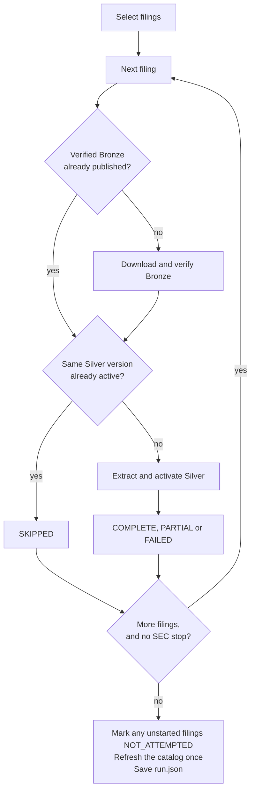

# Company run: selecting and processing one company's filings

## Purpose

A Bronze ingest starts from a known filing. The company run starts from a company: given a CIK and a bounded selection, it chooses the filings, gets each one into verified Bronze and active Silver, refreshes the catalog once, and saves a record of the attempt. It handles one company per invocation. The [end-to-end pipeline](end-to-end-pipeline.md) adds metadata and the dbt build after it, and the [cohort backfill](cohort-backfill.md) calls it once per company.

## Goals and non-goals

Goals:

- Make a selection reproducible: the same request against the same SEC listing picks the same filings.
- Give every selected filing an outcome, even when the run stops early.
- Reuse verified work and record each attempt separately.
- Keep one consistent pace of SEC requests across the whole company.

Non-goals:

- Picking a "latest" value for a fiscal period, or resolving amendments.
- Retrying around the request layer, or processing filings in parallel.
- Loading metadata or building Gold (the end-to-end pipeline does that).

## Selection

The input is a CIK, a set of exact forms, an optional inclusive filing-date window and an optional limit.

1. Read the company's SEC submissions listing (`filings.recent`) and save the raw response.
2. Keep rows whose form matches exactly. `10-K` doesn't match `10-K/A`, so amendments are included only if asked for.
3. Keep rows inside the filing-date window.
4. Sort by filing date, newest first, with accession number descending for ties.
5. Apply the limit.

Filtering comes before the limit. "Two 10-K or 10-Q filings filed in 2025" is a reproducible request; "take two recent filings and hope they match" is not. Filing date selects documents, it doesn't define the fiscal period: Microsoft's fiscal year ends in June, so a filing-date window says nothing about which fiscal year a filing covers. A filing's identity stays CIK plus accession; its report date is metadata, not a key.

For the cohort, the caller passes exact accessions from a frozen plan instead of a form and date filter, and discovery may also read the older listing files named in `filings.files`, bounded by a lower filing date. A missing planned accession is never replaced with the next filing. The run still validates the live listing first, and the cohort later compares form, dates, primary document and source listing with the saved plan.

## Design



1. **One client, one pacer.** Discovery and every filing share one HTTP client and request pacer, so moving to the next filing can't reset the spacing between SEC requests.
2. **Bronze.** An existing canonical filing is used only after its manifest verifies. An unusable existing folder is reported, never overwritten or downloaded around. A failed staging attempt is never treated as reusable Bronze.
3. **Silver.** A filing whose equivalent version is already active is `SKIPPED`. A version that exists on disk but isn't active doesn't count as usable.
4. **Keep going, or stop.** An invalid XBRL file fails that filing and the run moves on. A confirmed SEC block stops all further requests, and every filing not yet started is marked `NOT_ATTEMPTED`. No outer retry loop wraps the request layer.
5. **One catalog refresh.** After all filings, the catalog is rebuilt once from **every** active Silver pointer under the root, including other companies' earlier runs. Refreshing after each filing would rebuild the same views repeatedly, and a single refresh gives the later stages one consistent view.

## Outcomes

| Filing outcome | Meaning |
| --- | --- |
| `COMPLETE` | Usable active Silver, with no partial Bronze or Silver result |
| `PARTIAL` | Usable active Silver, but Bronze or the extraction was partial |
| `SKIPPED` | Verified Bronze and an equivalent active Silver version were reused |
| `FAILED` | The filing didn't produce usable active Silver |
| `NOT_ATTEMPTED` | The run stopped before this filing started |

The company result is `COMPLETE` when every filing is `COMPLETE` or `SKIPPED` and the catalog refresh is complete, `PARTIAL` when some usable Silver exists but something along the way was partial or failed, and `FAILED` when discovery fails or no selected filing produced usable Silver. An empty selection is a successful no-op and needs no catalog refresh. A failed catalog refresh keeps the company result `PARTIAL`, and the end-to-end pipeline then skips metadata and dbt.

## Run record

```text
<run root>/cik=<CIK>/run_id=<run-id>/
├── submissions.json   the SEC listing used for discovery
├── history/           older listing files, when this run needed them
└── run.json           selection, per-filing outcomes, catalog counts, paths, errors
```

A run ID names an execution, not a filing or a Silver version. Every run gets a new directory, so an earlier record is never overwritten, and repeating a selection reuses verified Bronze and Silver while recording a new attempt. Keeping execution evidence apart from source and version identity is what makes reruns inspectable without duplicating any facts.

`run.json` ties each saved listing to its URL, retrieval time, size and SHA-256, and lists the selected filings in processing order. Later, filing metadata for a historical accession points to the specific older listing it came from; a recent filing points to `submissions.json`. In the [cohort](../validation/cohort.md), 25 of these records were later used to load the 20 company profiles without a single new SEC request.

## Failure handling

- A filing failure is recorded and the run continues with the next filing.
- An SEC block stops the run; every remaining filing still gets an outcome.
- If saving `run.json` fails after Bronze or Silver work, that data stays published and the caller gets an error, rather than a record claiming the run finished.

## Trade-offs and limits

| Choice | Cost |
| --- | --- |
| One company per invocation | Many companies need the cohort runner or repeated calls |
| Filings processed one at a time | Slower than parallel workers, but SEC pacing stays simple and correct |
| One catalog refresh per run, over the whole Silver root | The refresh grows with the dataset, not with the company being processed |
| Exact form matching | Amendments must be requested explicitly |

## Code and tests

| Part | Code |
| --- | --- |
| Listing parsing and selection | [`company_filings.py`](../../src/sec_edgar_lakehouse/bronze/company_filings.py) |
| Per-filing processing and outcomes | [`company_processing.py`](../../src/sec_edgar_lakehouse/pipeline/company_processing.py) |
| Processing plus catalog refresh | [`company_pipeline.py`](../../src/sec_edgar_lakehouse/pipeline/company_pipeline.py) |
| Run record | [`company_run.py`](../../src/sec_edgar_lakehouse/pipeline/company_run.py) |
| Command line (`sec-edgar company`) | [`company_pipeline_run.py`](../../src/sec_edgar_lakehouse/pipeline/company_pipeline_run.py) |

The [pipeline tests](../../tests/pipeline/) cover selection, reuse, `NOT_ATTEMPTED` after a stop, catalog gating and record publication. The [Apple and Microsoft run](../validation/multi-company-acceptance.md) processed both companies into shared roots and confirmed that a rerun reused the published work.
