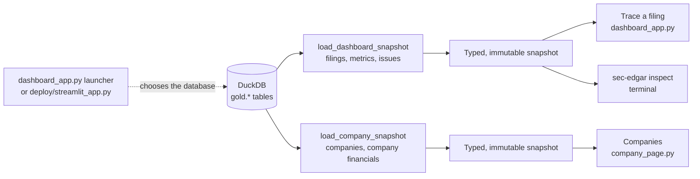
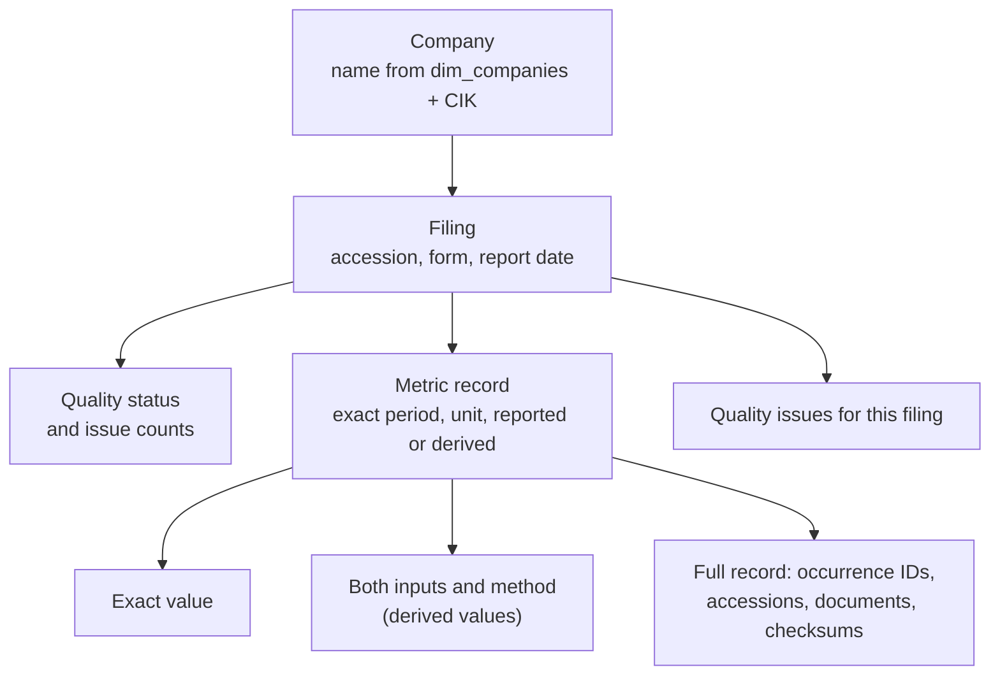
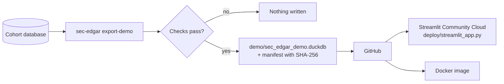

# Dashboard: company comparison and filing explorer

## Purpose

The dashboard is a read-only Streamlit app over the Gold tables. It has two views: **Companies** compares companies across fiscal years, and **Trace a filing** follows any value back to the filing, period and XBRL facts behind it. It shows what Gold stored and never recalculates a financial value, so what's on screen is exactly what the tests checked.

It runs locally against a built database, and publicly at [sec-lakehouse.streamlit.app](https://sec-lakehouse.streamlit.app/) against a small copy of Gold (see [Hosted demo](#hosted-demo)).

## Goals and non-goals

Goals:

- Read Gold through a typed, tested contract, independent of Streamlit.
- Show every value exactly: exact decimals, the full lineage, and both inputs of a derived value.
- Keep gaps visible: a withheld value is a gap with a reason, never a bridged line or a silent omission.
- Let the core package work without the UI libraries installed.

Non-goals:

- Writing to the database, running the pipeline or calling the SEC.
- Authentication. Everything shown is public SEC data.
- Serving reads while the pipeline is writing.

## Design



### The reader

[`dashboard_read.py`](../../src/sec_edgar_lakehouse/dashboard/dashboard_read.py) is the only code that queries the database. Each snapshot is one read-only DuckDB connection and one transaction, so a page never mixes two refreshes. It then closes the connection and returns immutable records.

- **A checked contract.** The reader selects known columns and checks their SQL types, instead of accepting any table that happens to have the right name. A missing or incompatible table is an error on the page, not an empty result.
- **Exact values.** Metric values stay Python `Decimal`, timestamps stay timezone-aware, and evidence arrays keep their order, including the difference between an empty list and a null.
- **No accidental joins.** Metrics and issues are returned separately. A filing can have several of each, and joining them would multiply both counts.
- **Bounded resources.** One DuckDB thread and a 4 GB memory limit, with insertion order preserved for evidence arrays. Filters are bound parameters, never SQL text from the page.

The UI depends on these snapshots, not on DuckDB, which keeps it testable with small fixture databases.

### Companies

The default view. Filters sit in one row: sector, up to six companies (by default the five with the largest latest annual revenue), a metric, and annual or quarterly periods. Changing the sector resets the selection. Below them are a line chart over fiscal periods, a ranking of every company in scope for its latest fiscal year, and a side-by-side table of the latest year.

A few rules keep the charts honest:

- **Gaps stay gaps.** A withheld value breaks the line instead of being bridged, and a company with no latest-year value is named under the ranking rather than dropped. Blank table cells are values Gold withheld.
- **Derived values are marked.** Points that come from a derived quarter, such as Q4 = annual − Q3 year to date, are hollow and labelled in the tooltip.
- **Colours belong to companies.** Six colours from a palette checked for colour-blind separation. A company keeps its colour while it stays selected, so removing one never repaints the others; with four or fewer companies, lines are labelled directly.
- **No new financial logic.** Decimals become floats only for drawing. Margins and growth come from the mart.

Fiscal years end in different months, so "FY2025 Q1" means different calendar months for Apple (September year end) and Microsoft (June). The chart caption says so. A database without the company tables shows how to load them instead of an empty chart.

### Trace a filing

The user picks a company, a filing and then an **exact metric record**, not just a metric name. A 10-Q can contain both a reported quarter and a reported year to date for the same metric, and picking "the revenue row" would hide that difference.



- **It opens on an example.** When the database contains Apple's derived FY2025 Q4 operating cash flow, the view opens on that record with a short note on how it was derived. Clearing the company keeps it cleared until the view is opened again; a database without that record opens empty.
- **Nothing is hidden.** `PARTIAL` and `FAILED` filings stay listed. Each filing keeps its own accession, amendments included, with no "latest filing" choice made for the user.
- **Status comes from Gold.** Quality statuses get success, warning or error styling, but the page never recomputes a status from issue counts. An empty missing-metrics list shows "None"; a null shows "Unavailable".
- **Formatting is display-only.** Values get commas and lose trailing fractional zeros, but no digit is rounded and nothing goes through a float. The full record shows the stored decimal text, raw unit and every lineage field. Unknown metric codes and units are shown as stored, not guessed.
- **Selections can't go stale.** Changing the company, filing or period clears the selections that depend on it, so an old row never appears under a new filter.

### Optional UI dependencies

Streamlit and Altair are in an optional dependency group. The core package, both readers, the terminal inspector and the demo export work without them; only `dashboard_app` and `company_page` import Streamlit. CI installs the built wheel without the UI group and imports every other module, and a local test blocks Streamlit and Altair to catch a leak before CI does.

## Running it locally

```sh
make dashboard                                        # the local cohort database
make dashboard DATABASE=data/query/sec_edgar.duckdb   # any existing database
uv run --locked sec-edgar inspect --database data/query/sec_edgar.duckdb --cik 0000320193
```

The [launcher](../../dashboard_app.py) resolves the database in this order: `SEC_EDGAR_DUCKDB_PATH`, then the ignored `data/dashboard-current.duckdb` link if it exists, then `data/query/sec_edgar.duckdb`. Relative paths resolve from the repository root. The inspector prints scope, counts and a small exact financial sample using the same reader.

Keep the dashboard closed while the pipeline writes. A read transaction gives a consistent snapshot of the database, but it can't make dbt's model-by-model writes or the external Parquet files atomic.

## Hosted demo

The local database can't be published as it is: its Silver views point to Parquet files by absolute path on the build machine, and `dim_filings` stores those paths too. The dashboard reads only Gold, so the public app reads a small copy of just the Gold tables.



[`demo_export.py`](../../src/sec_edgar_lakehouse/dashboard/demo_export.py) copies exactly the five Gold tables the dashboard reads, and:

- refuses a source whose Gold models are views, since a view would still need the Silver files;
- rewrites `dim_filings.version_path` and `publication_path` from absolute paths to paths relative to the data folder, such as `silver/cik=…`;
- refuses to finish if any text value still looks like a home, temp or drive path, contains an email address, or contains the data folder's own path;
- compares every row count with the source and opens the result with both dashboard readers;
- builds under a temporary name and moves the file into place only after all checks pass;
- writes `demo/sec_edgar_demo.json` with the file's SHA-256 and row counts.

```sh
make demo             # rebuild from the local cohort link
make demo-dashboard   # open it through the hosted entry point
```

The committed file is about 3 MB: 400 filings, 4,310 financial values, 557 issues, 20 companies and 500 company-period rows. It is a snapshot, re-exported after a Gold rebuild.

**Hosting.** Streamlit Community Cloud clones the repository, installs [`deploy/requirements.txt`](../../deploy/requirements.txt) and runs [`deploy/streamlit_app.py`](../../deploy/streamlit_app.py) on Python 3.14. The entry point adds `src/` to the import path instead of installing the package, so the host only needs the pinned packages. It opens the demo file unless `SEC_EDGAR_DUCKDB_PATH` says otherwise, then calls the same `main` as the local launcher: no reader, query or chart code differs between the two.

**Checks.** A separate CI job installs only `deploy/requirements.txt` and pytest on Python 3.12, the oldest version the source supports, and runs [the hosted-demo tests](../../tests/dashboard/test_hosted_demo.py): the committed file must match its manifest and contain only the five Gold tables, every pin must match `uv.lock`, and both views must open without errors. After a dependency change, the pins are regenerated from `uv.lock` with the `uv export` command written at the top of the requirements file. Ruff's target version keeps the source free of syntax newer than 3.12.

### Run it in Docker

The [`Dockerfile`](../../Dockerfile) packages the same hosted app: `python:3.14-slim`, the packages from `deploy/requirements.txt`, then only `src/`, the entry point, the demo database and the Streamlit theme. It runs as a non-root user with a health check on Streamlit's `/_stcore/health`, and [`.dockerignore`](../../.dockerignore) keeps `data/` and other large folders out of the build context.

```sh
docker build --tag sec-edgar-dashboard .
docker run --rm --publish 8501:8501 sec-edgar-dashboard
```

`make docker-run` does both. The image doesn't run the pipeline: it makes no SEC requests and contains no dbt project or Silver files. A CI job builds it, starts it and waits for the health check.

The demo has no Silver facts, so the `silver.facts` queries in the [pipeline guide](../guides/running-the-pipeline.md#inspect-the-results) only work on a local build ([decision 16](../decisions/engineering-decisions.md#16-the-live-demo-reads-a-gold-only-copy-not-the-pipelines-database)).

## Trade-offs and limits

| Choice | Cost |
| --- | --- |
| Read the whole snapshot per page load, then filter in memory | Fine for 400 filings; a much larger dataset would need filtered queries |
| One read-only connection, closed after each read | Reads must not overlap pipeline writes |
| The hosted app reads a Gold-only snapshot | It must be re-exported after each rebuild, and can't show raw Silver facts |
| Streamlit | Quick to build and easy to host, but limited layout control |

## Code and tests

| Part | Code |
| --- | --- |
| Readers and snapshot types | [`dashboard_read.py`](../../src/sec_edgar_lakehouse/dashboard/dashboard_read.py) |
| View selection and the filing explorer | [`dashboard_app.py`](../../src/sec_edgar_lakehouse/dashboard/dashboard_app.py) |
| Companies view and charts | [`company_page.py`](../../src/sec_edgar_lakehouse/dashboard/company_page.py) |
| Terminal inspector | [`dashboard_inspect.py`](../../src/sec_edgar_lakehouse/dashboard/dashboard_inspect.py) |
| Demo export | [`demo_export.py`](../../src/sec_edgar_lakehouse/dashboard/demo_export.py) |
| Local launcher, hosted entry point | [`dashboard_app.py`](../../dashboard_app.py), [`deploy/streamlit_app.py`](../../deploy/streamlit_app.py) |

The [dashboard tests](../../tests/dashboard/) cover the reader's column and type contract, empty and filtered selections, exact decimals and timestamps, ordered evidence, read errors, selection resets, the example trace and the demo export's path and email checks. The [Apple and Microsoft run](../validation/multi-company-acceptance.md) read a real database without changing its checksum.
