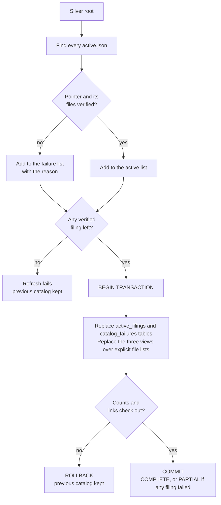
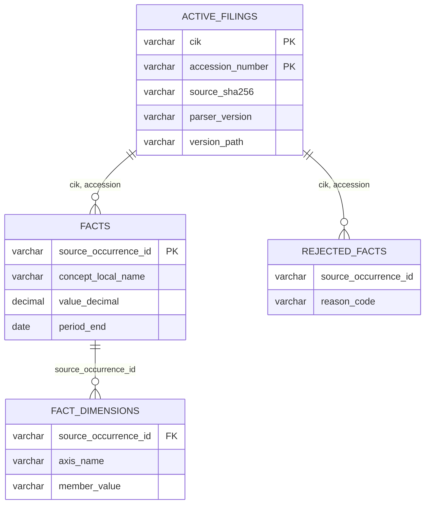

# DuckDB catalog: querying active Silver

## Purpose

Silver stores each filing's facts as immutable Parquet versions, with an `active.json` pointer choosing which version is current. The catalog turns the active versions into stable SQL names in a DuckDB database, so dbt and SQL tools can query every filing at once without knowing the folder layout.

The catalog is derived state. The active pointers and the files they point to remain the source of truth, and the catalog can be rebuilt from them at any time. In the [20-company cohort](../validation/cohort.md), one refresh exposed 400 active filings and 601,103 facts.

## Goals and non-goals

Goals:

- Expose only versions that an active pointer selects and that pass verification.
- Replace the whole catalog atomically: readers see the old catalog or the new one, never a mix.
- Report bad filings without hiding the good ones.
- Keep a single copy of the facts.

Non-goals:

- Copying Silver rows into DuckDB tables.
- Choosing a company total, calculating a metric or repairing a bad Silver version.
- Protecting the Parquet files from another process changing them during a query.

## Design



### Verification

For each active pointer, the refresh checks the referenced `publication.json` and the three Parquet files: identity, a parser and row-schema version the catalog supports, file names, schemas, row counts, sizes, SHA-256 hashes, unique fact IDs and that every dimension row links to a fact. A directory under `versions/` has no effect unless an active pointer selects it, and files are never found by a recursive search.

### The transaction

Inside one DuckDB transaction, the refresh replaces `silver.active_filings` and `silver.catalog_failures`, then recreates the three fact views, each over an explicit list of the verified Parquet files. Before committing, it checks the new relations: their row counts must equal the counts recorded in each `publication.json`, and the links must hold. Any problem rolls the whole thing back.

So `active_filings`, `catalog_failures` and the three views always describe the same set of files. If no verified filing remains, the refresh refuses to publish an empty catalog and the previous one stays usable.

Suppose Apple has a good active version and Microsoft's pointer is corrupt. The refresh includes Apple, records Microsoft's path and reason in `silver.catalog_failures`, and returns `PARTIAL`. If neither verifies, it fails and changes nothing.

### Views, not copies

```sql
CREATE OR REPLACE VIEW silver.facts AS
SELECT * FROM read_parquet([<verified file paths>], hive_partitioning = false)
```

A Silver version is already a checked dataset. Copying its rows into DuckDB would create a second copy to reconcile after every parser revision or failed run. Instead, only the catalog's own state, the active-filing list and the failures, are stored as tables, and DuckDB reads the Parquet files directly through views.

Two settings keep the schema honest:

- **`hive_partitioning = false`.** Folder names like `cik=…` and `schema=…` are storage layout. DuckDB would otherwise turn them into extra columns.
- **No `union_by_name`.** Every file must have the declared schema. Mixing incompatible versions isn't papered over with null columns, so a new row schema needs a deliberate catalog change.

## Data



| Relation | Kind | One row per |
| --- | --- | --- |
| `silver.active_filings` | Table | Verified active filing (key: CIK + accession), with its source and activation evidence |
| `silver.catalog_failures` | Table | Active pointer excluded from the latest refresh, with the reason |
| `silver.facts` | View over Parquet | Accepted XBRL occurrence |
| `silver.fact_dimensions` | View over Parquet | Dimension on an accepted occurrence |
| `silver.rejected_facts` | View over Parquet | Rejected numeric candidate |

The metadata tables (`silver.filing_metadata`, `silver.filing_fiscal_metadata`, `silver.company_profiles`) live in the same database but are loaded separately; a refresh doesn't rebuild them.

## Usage

```sh
uv run --locked sec-edgar catalog-refresh \
  --silver-directory data/silver/sec/filings \
  --database data/query/sec_edgar.duckdb
```

The refresh is explicit: publishing a new Silver version doesn't update DuckDB on its own. The company run refreshes once after processing its filings, and because it scans the whole Silver root, a later company's run includes every earlier company's active filings too. The refresh refuses a database path inside the Silver root, keeping derived state out of the source folder it describes.

## Failure handling

| Situation | Result |
| --- | --- |
| Some pointers fail verification | `PARTIAL`; the failures are listed in `silver.catalog_failures` |
| No pointer passes verification | The refresh fails; the previous catalog is untouched |
| A check fails inside the transaction | `ROLLBACK`; the previous catalog is untouched |

## Trade-offs and limits

| Choice | Cost |
| --- | --- |
| Views over Parquet instead of copied tables | Every query reads Parquet. That costs little for staging, and Gold's intermediate models and marts are stored as tables anyway ([decision 14](../decisions/engineering-decisions.md#14-gold-is-stored-as-tables-staging-stays-as-views)) |
| Views list absolute file paths | The `.duckdb` file isn't portable on its own. If the data moves, refresh from the new Silver root; the [hosted demo](dashboard.md#hosted-demo) copies Gold tables instead |
| The transaction covers the catalog definitions | It can't stop another process rewriting Parquet files mid-query. Silver versions are immutable and stages run one at a time, so the rule is one writer, with readers closed during writes |
| Strict schema, no `union_by_name` | A new Silver row schema needs a catalog change before it can be queried |

See [decision 6](../decisions/engineering-decisions.md#6-duckdb-is-a-catalog-of-views-not-a-second-copy-of-the-data).

## Code and tests

[`silver_catalog.py`](../../src/sec_edgar_lakehouse/catalog/silver_catalog.py) owns pointer discovery, verification, the transaction and the checks before commit. [`silver_catalog_refresh.py`](../../src/sec_edgar_lakehouse/catalog/silver_catalog_refresh.py) is its command line. The [catalog tests](../../tests/catalog/) cover bad pointers, partial refreshes, rollback, schema and link checks, and the supported parser versions.

In the [Apple and Microsoft run](../validation/multi-company-acceptance.md), the shared catalog held both companies' filings after the second run; adding Microsoft didn't remove Apple's records, and a rerun left the catalog rows unchanged.
