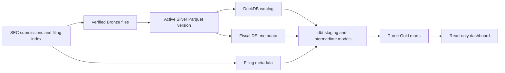

# End-to-end run: getting from a company selection to Gold

The company runner gets filings into Bronze and Silver and refreshes the catalog. The end-to-end runner adds verified filing and fiscal metadata, runs dbt once, and saves a final summary that points back to the stage evidence. It is the local entry point for a usable Gold dataset, not another place where financial rules are implemented.



The coordinator passes the same DuckDB path to catalog refresh, metadata storage, and dbt. It checks dbt project/profile paths and requires a fresh artifact directory before it starts company work. The first catalog refresh may create the database. Each stage runs at most once per invocation; SEC request retries stay in the request layer.

The explicit path handoff avoids a quiet but serious mistake: refreshing one database and building Gold against a different default profile path. The runner sets the database for the dbt subprocess without changing the parent's environment. It does not try to coordinate concurrent writers or replay the entire run after a failure.

## Stage gates

Metadata loading starts when the company run has at least one usable selected filing and this run's catalog refresh returned `COMPLETE` or `PARTIAL`. An old database file alone is not enough. `silver.filing_metadata` stores form, filing date, report date, and primary document from the saved SEC submissions response, together with its run ID and checksum. The loader verifies that response again and checks all active catalog filings for the CIK, not just those selected by this run's limit. It counts an identical row as already existing and reports missing or conflicting fields without replacing the first provenance. A conflict for one accession blocks that accession's fiscal load while other usable filings can continue.

`silver.filing_fiscal_metadata` reads `DocumentFiscalYearFocus`, `DocumentFiscalPeriodFocus`, and `DocumentPeriodEndDate` from the verified XBRL instance for usable **selected** filings. A usable DEI item must come from the filing's issuer, have an undimensioned duration context ending on the verified report date, and agree with the form where applicable. Repeated values are fine when they agree; conflicting values leave that field unresolved. Extraction keeps every recognized occurrence and its issues even when the result is `PARTIAL`.

The fiscal row's key includes the filing, active document name and checksum, and extraction version. Before insertion or reuse, the loader rechecks the active source and filing-metadata provenance inside its transaction; an identical rerun keeps the original row, including ordered evidence. Version `2` added strict context parsing. Version `3` also recognizes the SEC's `dei/2021q4` and `dei/2022q4` namespaces. Earlier rows remain in the table; Gold picks the highest supported version for the same active document. This let the 2021 Alphabet filing be reprocessed without overwriting the partial version `2` evidence.

| Stored relation | Row grain and handoff |
| --- | --- |
| `silver.filing_metadata` | One `(cik, accession_number)` with form, filing date, report date, primary document, saved listing URL/hash/path, and first accepted run ID. [`filing_metadata.py`](../../src/sec_edgar_lakehouse/metadata/filing_metadata.py) verifies the saved recent or historical listing again before insert or identical reuse. |
| `silver.company_profiles` | One `(cik, submissions_sha256)` with company name, tickers, exchanges, SIC code and description, SEC office (`ownerOrg`), filer category, fiscal year end, and the saved response's run ID, path, URL, retrieval time, size, and hash. [`company_profile.py`](../../src/sec_edgar_lakehouse/metadata/company_profile.py) rechecks the response bytes before insert; an identical response is `ALREADY_EXISTS`. |
| `silver.filing_fiscal_metadata` | One filing + active source document name/hash + extraction version, with DEI year/focus/end, extraction status, ordered occurrence JSON, issue JSON, and matching filing-metadata provenance. [`filing_fiscal_metadata.py`](../../src/sec_edgar_lakehouse/metadata/filing_fiscal_metadata.py) extracts; [`filing_fiscal_metadata_storage.py`](../../src/sec_edgar_lakehouse/metadata/filing_fiscal_metadata_storage.py) checks and stores. |

After filing metadata succeeds, the same saved submissions response is loaded into `silver.company_profiles`. A profile failure makes the metadata stage `PARTIAL` but does not block fiscal loading. The [company metadata loader](../../src/sec_edgar_lakehouse/metadata/company_metadata.py) joins those operations to the company result. A later run may find `ALREADY_EXISTS` rows, but a different listing checksum or active document is not allowed to borrow the earlier row's provenance. [Metadata tests](../../tests/metadata/) cover missing/conflicting source fields, fiscal evidence, active-source checks, and identical reuse.

The dbt build starts only when metadata is `COMPLETE` or `PARTIAL` and at least one fiscal load succeeded (`INSERTED` or `ALREADY_EXISTS`, with `COMPLETE` or `PARTIAL` extraction). It uses the explicit database and a new artifact directory. An empty company selection is a successful no-op that skips metadata and dbt. If an upstream gate fails, the summary records why downstream stages were skipped.

Execution uses `COMPLETE`, `PARTIAL`, or `FAILED`, with `SKIPPED` available on individual downstream stages. `PARTIAL` can mean useful earlier stages were retained even though Gold did not build; check the dbt stage before treating a run as Gold delivery. This is separate from financial quality: `gold.dim_filings` and `gold.metric_quality_issues` can report warnings after a successful dbt build.

| What happened | Final execution result | Why |
| --- | --- | --- |
| No filings matched | `COMPLETE`, metadata/dbt `SKIPPED` | A recorded no-op is not a failed pipeline. |
| No usable selected Silver | `FAILED`, downstream `SKIPPED` | There is no new selected data to build from. |
| Usable Silver but catalog refresh failed | `PARTIAL`, downstream `SKIPPED` | Published source work remains, but the current catalog handoff was not verified. |
| Metadata or dbt failed after earlier useful work | `PARTIAL` | The earlier outputs and diagnostics remain; Gold delivery needs its own stage check. |
| All stages completed, but Gold has warnings | `COMPLETE` execution | The warnings describe financial coverage, not an execution failure. |

## Evidence and failure boundaries

The company record keeps its exact submissions response and per-filing/catalog outcomes. The final end-to-end JSON includes stage statuses, skip reasons, the path and SHA-256 of that company record, and dbt artifact references. The dbt attempt keeps stdout, stderr, logs, `manifest.json`, and `run_results.json` when produced. New run IDs and artifact directories keep prior completed attempts intact.

The build runner checks its manifest and results artifacts and keeps the dbt invocation ID, so a summary can be matched to the build that actually ran. The final wrapper hashes the **saved** company record rather than reserializing an in-memory result. If final-summary writing fails, it reports that failure with the earlier stage results where available; it does not claim a completed summary or delete already published data.

```text
<company-run root>/cik=<CIK>/run_id=<run-id>/{submissions.json,run.json}
<end-to-end root>/cik=<CIK>/run_id=<run-id>.json
<dbt-artifact root>/.../{stdout.log,stderr.log,target/,logs/}
```

The CLI reads `SEC_USER_AGENT` from the environment and prints the final paths. Its module path is `sec_edgar_lakehouse.pipeline.end_to_end_pipeline_run`; see the [README](../../README.md) for a complete command.

There is no transaction spanning SEC responses, files, metadata tables, and dbt. Bronze exposes a verified canonical filing; Silver switches an active pointer after version checks; catalog refresh commits its tables/views together; and metadata loads use DuckDB transactions. A later failure does not roll these back. The final JSON is written through a temporary file and records whichever stages finished. A failed dbt build can leave some Gold relations replaced before a later model or test fails, so its artifacts and status need their own check. Connections are closed before dbt opens the database, and the local operating rule is one writer with dashboard/SQL readers closed during pipeline writes.

A company invocation selects one company's filings, but catalog refresh and dbt operate on **all** verified active filings in the shared roots/database. Loading Microsoft after Apple should leave Apple's records present. This runner does not backfill missing fiscal metadata for every older company, resolve amendments, or choose a latest filing for cross-company analysis. The [Gold design](gold-financial-metrics-V1.md) explains the rules that actually turn active facts into metrics.

## The module handoffs

| Handoff | Owner |
| --- | --- |
| CIK and exact accession selection | [`company_filings.py`](../../src/sec_edgar_lakehouse/bronze/company_filings.py) parses SEC submissions; [`cohort_run.py`](../../src/sec_edgar_lakehouse/pipeline/cohort_run.py) freezes a multi-company plan. |
| Filing index to verified source directory | [`filing_discovery.py`](../../src/sec_edgar_lakehouse/bronze/filing_discovery.py) and [`filing_inventory.py`](../../src/sec_edgar_lakehouse/bronze/filing_inventory.py) classify files; [`filing_request.py`](../../src/sec_edgar_lakehouse/bronze/filing_request.py) owns pacing/retry; [`filing_publication.py`](../../src/sec_edgar_lakehouse/bronze/filing_publication.py) publishes a checked directory. |
| Verified XML to active Parquet | [`silver_extraction.py`](../../src/sec_edgar_lakehouse/silver/silver_extraction.py) assigns occurrence IDs; [`silver_parquet.py`](../../src/sec_edgar_lakehouse/silver/silver_parquet.py) writes typed rows; [`silver_publication.py`](../../src/sec_edgar_lakehouse/silver/silver_publication.py) checks and activates a version. |
| Active pointers to SQL | [`silver_catalog.py`](../../src/sec_edgar_lakehouse/catalog/silver_catalog.py) verifies files and replaces catalog relations in one transaction. |
| Source listings and DEI to metadata | [`filing_metadata.py`](../../src/sec_edgar_lakehouse/metadata/filing_metadata.py) checks SEC listing provenance; [`filing_fiscal_metadata.py`](../../src/sec_edgar_lakehouse/metadata/filing_fiscal_metadata.py) extracts fiscal evidence; [`filing_fiscal_metadata_storage.py`](../../src/sec_edgar_lakehouse/metadata/filing_fiscal_metadata_storage.py) checks active provenance and stores it. |
| One company to Gold | [`company_run.py`](../../src/sec_edgar_lakehouse/pipeline/company_run.py) saves company evidence; [`end_to_end_pipeline.py`](../../src/sec_edgar_lakehouse/pipeline/end_to_end_pipeline.py) applies stage gates; [`dbt_build.py`](../../src/sec_edgar_lakehouse/pipeline/dbt_build.py) runs one build; [`end_to_end_run.py`](../../src/sec_edgar_lakehouse/pipeline/end_to_end_run.py) saves the final summary. |
| Gold to a screen | [`dashboard_read.py`](../../src/sec_edgar_lakehouse/dashboard/dashboard_read.py) reads a typed snapshot; [`dashboard_app.py`](../../src/sec_edgar_lakehouse/dashboard/dashboard_app.py) presents it without recalculating metrics. |

Each command-line module also runs as a `sec-edgar` subcommand through [`cli.py`](../../src/sec_edgar_lakehouse/cli.py), which forwards the remaining arguments to the module's `main`, so options and exit codes are unchanged. The [cohort design](cohort-backfill-V1.md) explains why a fixed 20-issuer plan sits around these same company APIs instead of replacing them. The [Gold note](gold-financial-metrics-V1.md) traces a real metric through this map.

## Guarantees and limits

| Current V1 guarantee | Boundary that still matters |
| --- | --- |
| Bronze and Silver reuse checks the saved source and publication evidence. | A staged file or inactive version is not queryable merely because it exists. No transaction spans both layers. |
| A Silver occurrence retains exact source identity, raw value, unit, and `DECIMAL(38,18)` when representable. | Gold maps eight metric codes, not every taxonomy concept or issuer extension. |
| Catalog refresh commits its active table, failure table, and fact views together after verification. | It does not freeze external Parquet files against another process modifying them. Use one writer. |
| Metadata rows keep the first verified SEC and active-document provenance on an identical rerun. | Later conflicting source evidence is reported, not silently substituted. |
| Selected and derived Gold rows carry current and, where applicable, predecessor occurrence IDs and exact values. | A missing or conflicting predecessor gives an issue, not a fabricated quarter. dbt does not publish all marts atomically. |
| The dashboard uses a read-only DuckDB connection and keeps full lineage in the detail record. | The database references absolute local Parquet paths; copying only the `.duckdb` file is insufficient. The [hosted demo](dashboard-V1.md#hosted-demo) copies only the Gold tables for that reason. |

## Where the claims are checked

| Claim | Code-level check | Saved acceptance evidence |
| --- | --- | --- |
| SEC pacing, terminal blocks, and verified Bronze reuse | [Bronze request/publication tests](../../tests/bronze/) and [company pipeline tests](../../tests/pipeline/test_company_pipeline.py) | [Cohort run report](../validation/cohort-V1.md) and per-company `run.json` files under its ignored data root |
| Candidate/rejection conservation, exact Decimal, and active-version reuse | [Silver extraction/publication tests](../../tests/silver/) | Cohort `active.json`, publication manifests, and 601,103 accepted rows in the [audit](../validation/cohort-V1.md) |
| Catalog snapshot and metadata provenance | [Catalog tests](../../tests/catalog/) and [metadata tests](../../tests/metadata/) | [Apple/Microsoft preservation check](../validation/multi-company-acceptance-V1.md) and cohort's 400 active/metadata rows |
| Gold grain, accuracy, period, derivation, and lineage | [dbt SQL tests](../../transform/tests/), [unit tests](../../transform/models/), and [offline dbt script](../../scripts/ci/validate_offline_dbt.py) | Synthetic 33-row fixture in [CI validation](../validation/ci-V1.md); separately, the real cohort's 4,015 metrics, 487 issues, and 8,406 checked metric-support references |
| Read-only UI and unchanged source records | [Dashboard reader/UI tests](../../tests/dashboard/) and [wheel probe](../../scripts/ci/wheel_probe.py) | [Two-company checksum check](../validation/multi-company-acceptance-V1.md) and [cohort read-only smoke](../validation/cohort-V1.md) |

The synthetic CI fixture checks repeatable behavior without SEC access. The separate cohort audit checks 20 real issuers and the filings in its frozen plan.
