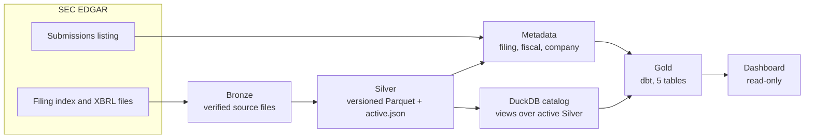
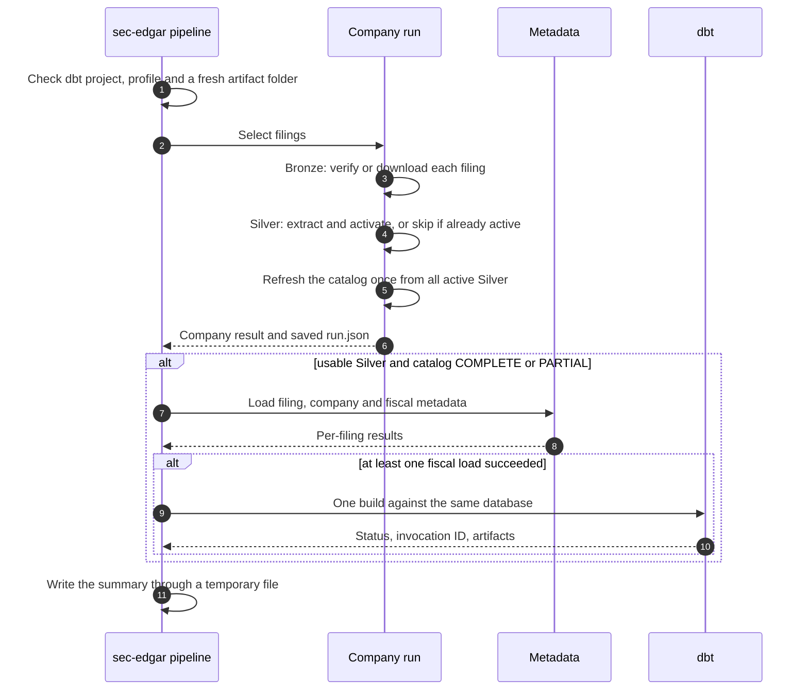

# End-to-end pipeline

## Purpose

`sec-edgar pipeline` takes one company's SEC filings through every layer, Bronze, Silver, the DuckDB catalog, metadata and the dbt Gold build, and writes a summary that points back to the evidence from each stage. This document covers how the stages connect and what happens when one of them fails. Each layer has its own document for its internals.

The runner decides order and gates. It contains no financial rules: those live in dbt, so a value is chosen in exactly one place.

The same stages ran the [20-company cohort](../validation/cohort.md): 400 filings and 601,103 XBRL facts on one machine, with a full Gold rebuild taking about 18 seconds.

## Goals and non-goals

Goals:

- Run each stage at most once per invocation, and only when its input is usable.
- Keep every stage's evidence, so a result can be traced and a failure diagnosed after the fact.
- Make reruns safe: verified work is reused, not redone or overwritten.
- Report whether the run worked separately from whether the financial data is complete.

Non-goals:

- Scheduling, parallel workers or concurrent writers. This is a local, sequential, single-writer pipeline.
- A transaction across files, DuckDB and dbt. Each stage commits on its own (see [Failure handling](#failure-handling)).
- Choosing a latest filing, resolving amendments or backfilling metadata for companies outside the run.

## Design



A run has four stages. Each one starts only if the previous one produced something usable:



1. **Company run.** [Selects the filings](company-pipeline-orchestration.md), gets each into verified [Bronze](bronze-ingestion.md) and active [Silver](silver-processing.md), then refreshes the [catalog](duckdb-query-catalog.md) once. The selection covers one company, but the catalog refresh and dbt build cover every active filing in the shared roots, so loading Microsoft after Apple keeps Apple's records.
2. **Metadata.** Loads the form, report date, fiscal period and company profile that Gold needs and the XBRL numbers can't provide (details below). It runs only if this run's catalog refresh was `COMPLETE` or `PARTIAL`; an old database file from an earlier run isn't enough.
3. **dbt build.** Runs once, against the same database, with a new artifact folder. It runs only if metadata was `COMPLETE` or `PARTIAL` and at least one fiscal load succeeded. The runner records the dbt invocation ID and checks that `manifest.json` and `run_results.json` exist, so the summary can be matched to the build that ran.
4. **Summary.** Records every stage's status and skip reason.

Reruns rely on this reuse. In the cohort's latest attempts, 341 filings were processed new and 59 were reused after re-verification, with none failed or left unattempted.

The same DuckDB path is passed explicitly to the catalog refresh, the metadata loaders and the dbt subprocess. Otherwise it would be easy to refresh one database and build Gold against a different default in `profiles.yml`. SEC retries happen only inside the request layer; no stage is retried by the runner.

### Metadata

| Table | Key | Source |
| --- | --- | --- |
| `silver.filing_metadata` | CIK + accession | The saved SEC submissions listing, rechecked against its SHA-256 before insert: form, filing date, report date, primary document |
| `silver.company_profiles` | CIK + listing SHA-256 | The same listing: name, tickers, SIC industry, SEC office, fiscal year end |
| `silver.filing_fiscal_metadata` | Filing + active document + extraction version | DEI facts in the verified XBRL file: fiscal year, fiscal period, period end |

A fiscal value is used only if its DEI fact belongs to the filing's issuer, has no dimensions, ends on the verified report date and agrees with the form. Values that repeat and agree are fine; values that conflict leave the field unresolved rather than picking one. Each row records the extraction version that produced it, and rows from different versions are kept side by side; Gold uses the newest one for the active document. That is how support for the SEC's `dei/2021q4` and `dei/2022q4` namespaces was added: a 2021 Alphabet filing was reprocessed without overwriting its earlier partial result.

An identical rerun returns `ALREADY_EXISTS` and keeps the first row's provenance. A different listing checksum or active document can't reuse an earlier row. A conflict blocks only the affected filing's fiscal load; a company-profile failure makes the stage `PARTIAL` without blocking fiscal loading.

## Outcomes

The run reports `COMPLETE`, `PARTIAL` or `FAILED`; individual downstream stages can be `SKIPPED`. This is separate from data quality: a `COMPLETE` run can still have Gold warnings in `gold.dim_filings` and `gold.metric_quality_issues`.

| What happened | Run result | Why |
| --- | --- | --- |
| No filings matched the selection | `COMPLETE`, metadata and dbt `SKIPPED` | A recorded no-op is not a failure |
| No selected filing produced usable Silver | `FAILED`, downstream `SKIPPED` | There is nothing new to build from |
| Usable Silver, but the catalog refresh failed | `PARTIAL`, downstream `SKIPPED` | Source work is kept; the catalog handoff wasn't verified |
| Metadata or dbt failed after earlier useful work | `PARTIAL` | Earlier outputs and diagnostics remain; Gold needs its own check |
| Every stage completed | `COMPLETE` | Gold warnings describe coverage, not a broken run |

A run leaves:

```text
<company-run root>/cik=<CIK>/run_id=<run-id>/{submissions.json, history/, run.json}
<end-to-end root>/cik=<CIK>/run_id=<run-id>.json
<dbt-artifact root>/.../{stdout.log, stderr.log, target/manifest.json, target/run_results.json, logs/}
```

The summary JSON holds each stage's status and skip reason, the path and SHA-256 of the saved company record, and the dbt artifact paths. It hashes the record as saved on disk, not a re-serialized copy, so the hash identifies the actual file. New run IDs and artifact folders never overwrite an earlier attempt.

## Failure handling

Each stage commits its own output; a later failure doesn't undo an earlier one.

| Stage | What commits as a unit | If a later stage fails |
| --- | --- | --- |
| Bronze | One filing directory, moved into place after verification | The filing stays published and is reused next time |
| Silver | One version, made active by switching `active.json` | The active version stays; readers never see a partial one |
| Catalog | All catalog tables and views, in one DuckDB transaction | The refreshed catalog stays |
| Metadata | Each load, in its own DuckDB transaction | Loaded rows stay |
| dbt | Each model separately | Some Gold tables may be replaced before a later model fails; check the build status and artifacts before using Gold |
| Summary | The JSON, via a temporary file | A write failure is reported with the earlier stage results; published data is not deleted |

A transaction spanning all of these would need coordination between the filesystem, DuckDB and dbt that a local pipeline doesn't justify. Atomic steps plus recorded status are enough here: a reader never sees a half-written Bronze filing, Silver version or catalog, and the summary says exactly how far a run got. dbt is the exception, which is why its status has to be checked before Gold is used. Connections are closed before dbt opens the database, and the dashboard and SQL tools should stay closed while the pipeline writes.

## Trade-offs and limits

| Choice | Cost |
| --- | --- |
| Reuse rechecks saved evidence instead of trusting existing files | Reruns do extra hashing; a staged file or inactive version is never treated as published |
| Silver keeps exact source identity and `DECIMAL(38,18)` values | Gold maps eight metrics, not every taxonomy concept or company extension |
| The catalog commits its definitions in one transaction | It can't stop another process changing the Parquet files mid-query, hence one writer |
| Metadata keeps the first verified provenance | Later conflicting evidence is reported, not substituted |
| Derived quarters need a matching predecessor | A missing predecessor is an issue, not an estimated value |
| The catalog points at Parquet files by absolute path | Copying only the `.duckdb` file isn't enough; the [hosted demo](dashboard.md#hosted-demo) copies only Gold tables for that reason |

The reasoning behind these is in the [engineering decisions](../decisions/engineering-decisions.md), especially decisions 5, 6, 9 and 10. For 20 companies at once, the [cohort backfill](cohort-backfill.md) wraps these same APIs in a frozen plan.

## Code and tests

| Part | Code |
| --- | --- |
| Filing selection | [`company_filings.py`](../../src/sec_edgar_lakehouse/bronze/company_filings.py) |
| Bronze | [`filing_discovery.py`](../../src/sec_edgar_lakehouse/bronze/filing_discovery.py), [`filing_inventory.py`](../../src/sec_edgar_lakehouse/bronze/filing_inventory.py), [`filing_request.py`](../../src/sec_edgar_lakehouse/bronze/filing_request.py), [`filing_publication.py`](../../src/sec_edgar_lakehouse/bronze/filing_publication.py) |
| Silver | [`silver_extraction.py`](../../src/sec_edgar_lakehouse/silver/silver_extraction.py), [`silver_parquet.py`](../../src/sec_edgar_lakehouse/silver/silver_parquet.py), [`silver_publication.py`](../../src/sec_edgar_lakehouse/silver/silver_publication.py) |
| Catalog | [`silver_catalog.py`](../../src/sec_edgar_lakehouse/catalog/silver_catalog.py) |
| Metadata | [`filing_metadata.py`](../../src/sec_edgar_lakehouse/metadata/filing_metadata.py), [`company_profile.py`](../../src/sec_edgar_lakehouse/metadata/company_profile.py), [`filing_fiscal_metadata.py`](../../src/sec_edgar_lakehouse/metadata/filing_fiscal_metadata.py), [`filing_fiscal_metadata_storage.py`](../../src/sec_edgar_lakehouse/metadata/filing_fiscal_metadata_storage.py), joined by [`company_metadata.py`](../../src/sec_edgar_lakehouse/metadata/company_metadata.py) |
| Stages and gates | [`company_run.py`](../../src/sec_edgar_lakehouse/pipeline/company_run.py), [`end_to_end_pipeline.py`](../../src/sec_edgar_lakehouse/pipeline/end_to_end_pipeline.py), [`dbt_build.py`](../../src/sec_edgar_lakehouse/pipeline/dbt_build.py), [`end_to_end_run.py`](../../src/sec_edgar_lakehouse/pipeline/end_to_end_run.py) |
| Command line | [`cli.py`](../../src/sec_edgar_lakehouse/cli.py) forwards each `sec-edgar` subcommand to its module's `main` |

| Claim | Automated check | Evidence from a real run |
| --- | --- | --- |
| SEC pacing, terminal blocks, verified Bronze reuse | [Bronze tests](../../tests/bronze/), [company pipeline tests](../../tests/pipeline/test_company_pipeline.py) | [Cohort report](../validation/cohort.md) and each company's `run.json` |
| Every candidate accepted or rejected, exact decimals, active-version reuse | [Silver tests](../../tests/silver/) | 601,103 accepted facts in the [cohort audit](../validation/cohort.md) |
| Catalog snapshot and metadata provenance | [Catalog tests](../../tests/catalog/), [metadata tests](../../tests/metadata/) | [Apple and Microsoft run](../validation/multi-company-acceptance.md); 400 active and metadata rows in the cohort |
| Gold grain, accuracy, periods, derivations, lineage | [dbt tests](../../transform/tests/), [unit tests](../../transform/models/), [offline dbt script](../../scripts/ci/validate_offline_dbt.py) | Synthetic fixture in [CI](../validation/ci.md); 8,406 metric-support references checked back to Silver in the cohort |
| Read-only dashboard, unchanged source records | [Dashboard tests](../../tests/dashboard/), [wheel probe](../../scripts/ci/wheel_probe.py) | Database checksum unchanged in the [Apple and Microsoft run](../validation/multi-company-acceptance.md) |
