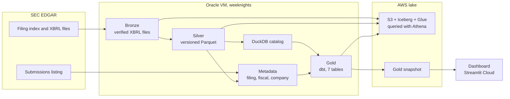
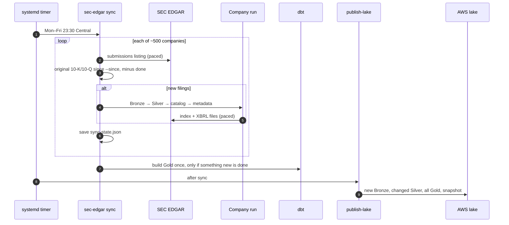

# End-to-end pipeline

## Purpose

`sec-edgar sync` keeps a universe of companies current. For each company it finds the original 10-K and 10-Q filings that aren't done yet and takes them through every layer, Bronze, Silver, the DuckDB catalog and metadata, then builds Gold once with dbt. `sec-edgar publish-lake` then puts the result in the lake on AWS. On the Oracle VM both run Monday to Friday nights ([cloud architecture](cloud-lakehouse.md)).

This document covers how the stages connect and what happens when one fails. Each layer has its own document for its internals. The runner decides order and gates; it contains no financial rules. Those live in dbt, so a value is chosen in exactly one place.

## Goals and non-goals

Goals:

- Process each filing once, and only the filings that aren't done.
- Keep every stage's evidence, so a result can be traced and a failure diagnosed after the fact.
- Make reruns safe: verified work is reused, never redone or overwritten. A failed filing is tried again the next night without anyone stepping in.
- Report whether the run worked separately from whether the financial data is complete.

Non-goals:

- Parallel workers or concurrent writers. One process writes at a time; the sync takes a lock on its data root.
- A transaction across files, DuckDB and dbt. Each stage commits on its own (see [Failure handling](#failure-handling)).
- Amendments. 10-K/A and 10-Q/A filings are left out until Gold has a policy for them.

## Design

One weeknight run:

### Choosing what to process

For each company the sync reads the SEC submissions listing, keeps the original 10-K and 10-Q filings filed on or after `--since` (January 1 five years back by default), and subtracts the ones its state already marks done. A filing counts as done when Bronze, Silver and its fiscal metadata all succeeded, or when an earlier run's verified work was safely reused. Anything else, a failed download, a Silver rejection, missing fiscal metadata, stays pending and is retried the next night. A filing that fails five nights in a row is set aside and listed under `set_aside` in each night's summary, so one filing the parser can't read doesn't keep every night `PARTIAL`.

A company's first run reads the SEC's older listing files too, which is the five-year backfill. Once every filing in range is done, only the recent listing is read, about one request per company per night; until then the older files are read again, so a failed old filing can't drop out of view. The universe file groups the public S&P 500 constituents list by CIK, so share classes such as GOOGL and GOOG are one issuer; [`scripts/build_universe.py`](../../scripts/build_universe.py) rebuilds it when the index changes. A universe ticker the SEC doesn't list for that CIK is recorded as a warning, not a failure.

### Stages per company

1. **Company run.** [Selects the filings](company-pipeline-orchestration.md), gets each into verified [Bronze](bronze-ingestion.md), extracts it to [Silver](silver-processing.md) and refreshes the [DuckDB catalog](duckdb-query-catalog.md). Verified Bronze and Silver are reused rather than redone. The run's record keeps the exact submissions response it chose from.
2. **Metadata.** Loads filing metadata from that saved response, fiscal year and period from each filing's own DEI facts, and the company profile. This is the same step the [cohort](cohort-backfill.md) uses.

Gold is built once at the end of the night by [`build_gold`](../../src/sec_edgar_lakehouse/pipeline/dbt_build.py), with a fresh profile and artifact folder per attempt. DuckDB's memory cap comes from `SEC_EDGAR_DUCKDB_MEMORY_LIMIT`, so the build can't starve other work on the VM. With nothing new, Gold isn't rebuilt.

### Publishing

`publish-lake` writes in four steps, each incremental where it can be: new Bronze filings are gzipped to S3 once, Silver goes to Iceberg only for filings whose active version changed, the seven Gold tables are overwritten (one Iceberg snapshot per night), and the Gold-only snapshot file goes to S3 for the dashboard. The [cloud architecture](cloud-lakehouse.md#publishing-to-the-lake) has the details.

## Status and evidence

| Where | What it says |
| --- | --- |
| `<root>/sync-state.json` | Per company: done accessions, the last run's outcomes and errors, whether the backfill happened |
| `<root>/sync-runs/<UTC time>.json`, `latest.json` | Per night: companies checked, filings done, failures, company errors, the Gold build, warnings |
| `<root>/runs/cik=<CIK>/run_id=<id>/run.json` | Per company run: the listing it chose from and each filing's outcome |
| `<root>/lake/publish-runs/latest.json` | What the last publish wrote; also uploaded to `runs/` in the lake |

The night's status is `COMPLETE` when every filing is done and Gold built, `PARTIAL` when some filings or companies failed, and `FAILED` when the run stopped on an SEC block or Gold failed to build. The exit code follows it: 0, 2, and 1 when the run couldn't start (missing `SEC_USER_AGENT`, a bad universe file, another sync holding the lock). A partial night still publishes what succeeded.

These describe execution only. Financial completeness is a separate question answered in Gold by `dim_filings.quality_status` and `metric_quality_issues` ([decision 9](../decisions/engineering-decisions.md#9-did-the-pipeline-run-and-is-the-data-good-are-separate-statuses)).

## Failure handling

| What failed | What happens |
| --- | --- |
| One filing's download or parse | Recorded with its reason; the company's other filings go on; retried next night |
| One company's listing (e.g. a retired CIK) | Recorded as a company error; the run moves to the next company |
| SEC block page or a long `Retry-After` | The whole run stops, Gold isn't built, state is saved; the next night starts where this one stopped |
| Gold build | Night is `FAILED`; the lake keeps last night's Gold, since publish copies Gold from the database as it stands |
| The VM is off on a weeknight | Nothing runs; the next run picks up everything it missed. Weekends are not made up |

There is no rollback across stages: published Bronze and Silver stay, and dbt can leave some Gold tables rebuilt and others not. Reruns are the recovery path, which is why every stage is safe to repeat.

## Code and tests

| Part | Code | Tests |
| --- | --- | --- |
| Nightly sync | [`universe_sync.py`](../../src/sec_edgar_lakehouse/pipeline/universe_sync.py) | [`test_universe_sync.py`](../../tests/pipeline/test_universe_sync.py) |
| Company run | [`company_run.py`](../../src/sec_edgar_lakehouse/pipeline/company_run.py) | [`test_company_run.py`](../../tests/pipeline/test_company_run.py) |
| Gold build | [`dbt_build.py`](../../src/sec_edgar_lakehouse/pipeline/dbt_build.py) | [`test_dbt_build.py`](../../tests/pipeline/test_dbt_build.py) |
| Lake publish | [`lake/publish.py`](../../src/sec_edgar_lakehouse/lake/publish.py) | [`test_publish.py`](../../tests/lake/test_publish.py) |
| Whole path, synthetic filings | [`validate_offline_dbt.py`](../../scripts/ci/validate_offline_dbt.py) | [CI](../validation/ci.md) |
