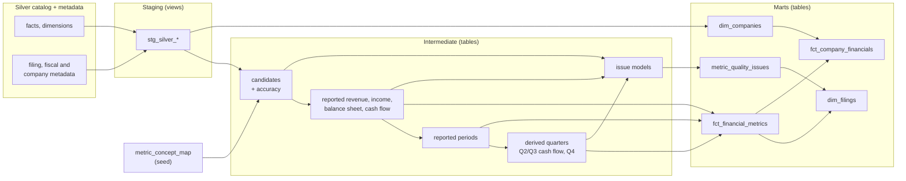
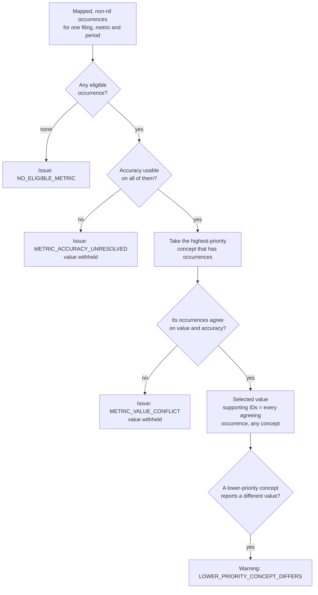
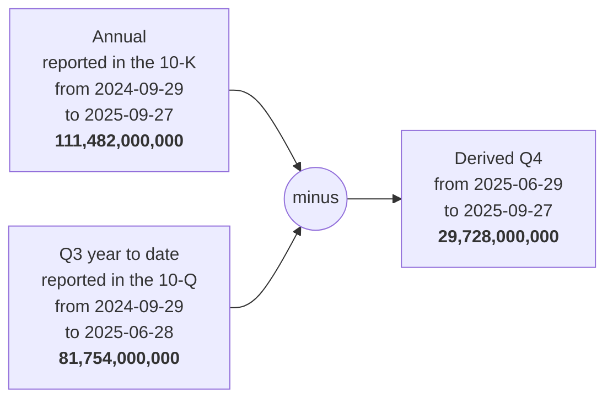

# Gold: choosing financial values

## Purpose

Silver keeps every accepted XBRL occurrence, often several for the same number. Gold decides which occurrence can stand for a company's metric in a given filing and period, derives quarters that companies don't report on their own, and records an issue whenever the evidence can't support a value. All of it is SQL in a dbt project, with data tests and unit tests on every rule.

In the [20-company cohort](../validation/cohort.md), Gold published 4,310 values (3,576 reported, 734 derived) from 601,103 facts, and recorded 557 quality issues.

## Goals and non-goals

Goals:

- Select at most one value per filing, metric and exact period, and only when the evidence agrees.
- Keep the full lineage of every value: the occurrence IDs, accessions, documents and checksums it came from.
- Derive a missing quarter only when both inputs are unambiguous and compatible.
- Make every gap explainable: a missing value always has an issue row with a reason.
- Keep the rules reviewable: concept mappings in a seed file, one model per decision.

Non-goals:

- Picking the latest amendment or restatement across filings.
- Reconciling accounting policies between companies or converting currencies.
- Summing segments into a consolidated total, or inventing zero values.

## Metrics

| Metric | Period | Unit | Required for a `COMPLETE` filing |
| --- | --- | --- | --- |
| `revenue` | duration | USD | Yes |
| `net_income` | duration | USD | Yes |
| `diluted_eps` | duration | USD per share | Yes |
| `total_assets` | instant | USD | Yes |
| `total_liabilities` | instant | USD | Yes |
| `cash_and_equivalents` | instant | USD | No |
| `operating_cash_flow` | duration | USD | No |
| `capital_expenditures` | duration | USD | No |

Each metric maps to US-GAAP concepts in [`metric_concept_map.csv`](../../transform/seeds/metric_concept_map.csv), a dbt seed, so the vocabulary is reviewable in one place instead of being buried in `CASE` expressions. Three metrics have fallback concepts, in priority order:

| Metric | Concepts, highest priority first | Why this order |
| --- | --- | --- |
| `revenue` | `Revenues`, `RevenueFromContractWithCustomerExcludingAssessedTax`, `SalesRevenueNet` | Total revenue first. Contract revenue leaves out items such as Walmart's membership income or Berkshire's insurance premiums |
| `net_income` | `NetIncomeLoss`, `ProfitLoss` | Income attributable to the company first. `ProfitLoss` includes noncontrolling interests and is used only when a company doesn't report `NetIncomeLoss` (Broadcom, Mastercard) |
| `capital_expenditures` | `PaymentsToAcquirePropertyPlantAndEquipment`, `PaymentsToAcquireProductiveAssets`, `PaymentsToAcquireOtherPropertyPlantAndEquipment` | Property and equipment first. Amazon, NVIDIA and Visa report capex as productive assets; Eli Lilly as other property and equipment |

## Design

| Layer | Materialized as | Job |
| --- | --- | --- |
| Staging | Views | Expose active Silver facts and the verified metadata with their original names and types. No financial choices |
| Intermediate | Tables | One model per decision: candidates, accuracy, reported selection per metric family, period labels, derivations, and the issues each step finds |
| Marts | Tables | The five published tables |

Staging stays as views so DuckDB never holds a second copy of the Silver facts. Intermediate models and marts are tables, computed once per build. With everything as views, every test and every dashboard read recomputed the whole chain over about 600,000 facts: a full build took 34 minutes and the dashboard ran out of memory. As tables, the same build takes about 18 seconds ([decision 14](../decisions/engineering-decisions.md#14-gold-is-stored-as-tables-staging-stays-as-views)).

## Selecting a reported value

**Eligibility.** An occurrence must belong to the filing's issuer and active document, have the right duration or instant kind, use exactly the unit expected for the metric, and have no dimensions, since these are consolidated values. The filing must have verified metadata, a supported form and a report date that matches.

**Accuracy.** XBRL facts carry `decimals` or `precision`. An occurrence needs exactly one usable attribute: an integer or `INF` for `decimals`, a non-negative integer or `INF` for `precision`, where zero precision means unknown. If any occurrence in the group fails this, the value is withheld, rather than choosing the cleaner duplicate and hiding the bad one. This came from a real bug: a candidate with `decimals="not-a-valid-accuracy"` had been selected because identical invalid values "agreed".

**Priority picks the concept, never the value.** Within the highest-priority concept the filing reports, every occurrence must agree. Priority is never used to choose between two different values of the same concept.

**Evidence keeps every agreeing fact.** The selected row's `supporting_occurrence_ids` lists every usable occurrence, of any mapped concept, that reports exactly that value. A lower-priority concept with a *different* value doesn't block the selection; it becomes a warning with its occurrence IDs. Walmart's FY2026 10-K reports `Revenues` of 713,163,000,000 USD and contract revenue of 706,413,000,000 USD: Gold publishes the first and keeps the second visible as a warning. When both concepts agree, both IDs are kept and no warning is written. Deduplicating in Silver would have destroyed the evidence needed to tell those two cases apart.

### Periods

A reported value is labelled `annual`, `quarter`, `year_to_date` or `instant` using the filing's verified fiscal focus, its form and its dates together. Duration alone never names a fiscal period:

| Fiscal focus | Label | Duration window |
| --- | --- | --- |
| FY | `annual` | 350–380 days |
| Q1, Q2, Q3 | `quarter` | 80–100 days |
| Q2 | `year_to_date` | 170–200 days |
| Q3 | `year_to_date` | 260–290 days |

The windows are checked only **after** form, fiscal focus, lineage and report date agree. An instant must fall on the report date. Two eligible periods competing for the same label are reported as ambiguous, and a value whose dates fit no window becomes `UNSUPPORTED_DURATION`.

## Deriving quarters

Two kinds of quarter can be derived:

| Method | Metrics | Calculation |
| --- | --- | --- |
| `CURRENT_YTD_MINUS_PREVIOUS_CUMULATIVE` | Operating cash flow, capex (Q2 and Q3) | This filing's year to date minus the previous filing's cumulative value |
| `ANNUAL_MINUS_Q3_YTD` | Revenue, net income, operating cash flow, capex (Q4) | The annual value minus the Q3 year to date |

Both inputs must belong to the same company and fiscal year and agree on start date, report dates, form, unit and dimensions, with a plausible quarter length left over. Predecessor candidates are counted **before** compatibility is checked. If two Q3 filings could supply the subtraction, Gold reports ambiguity instead of quietly using whichever one passes a later filter. A reported quarter always wins over a derived one. The result is cast back to exact `DECIMAL(38,18)`, and an out-of-range result is an issue.

A missing predecessor leaves the reported annual or year-to-date value in place and the quarter absent, with a `MISSING_PREVIOUS_CUMULATIVE` issue. No zero, estimate or other company's value is substituted. Diluted EPS is never derived, because subtracting per-share figures isn't valid in general.

Derived rows are labelled `derived_quarter` and keep both operands, both accessions, documents and checksums, both supporting ID lists and the method. The cohort has 734: 388 Q4s and 346 Q2/Q3 cash-flow quarters.

## Trace one Q4 value back to the filing

Apple's FY2025 Q4 operating cash flow, step by step:

1. **SEC listings.** CIK `0000320193`. The 10-K is `0000320193-25-000079`, filed 2025-10-31 for the period ending 2025-09-27. The Q3 10-Q is `0000320193-25-000073`, filed 2025-08-01 for the period ending 2025-06-28. Filing dates selected the documents; they don't define the cash-flow periods.
2. **Bronze.** Both archives are `COMPLETE` and parser-ready. The verified XML files are `aapl-20250927_htm.xml` (SHA-256 `e1076735f1c81bc96d5c1ff6e1a9d23515d6eacf52b405cb1f7da3e379ac533b`) and `aapl-20250628_htm.xml` (SHA-256 `a33da25d38ddc3c39fcb80b996a26fb562b8938f942f7a41a5f156339a7d70c9`).
3. **Silver.** The annual `NetCashProvidedByUsedInOperatingActivities` fact sits at XML position 515: raw `111482000000`, `decimals="-6"`, USD. Its occurrence ID is `8d666449ebbf6e5a9e18a56f4a8690e82ca9b8ffb566f279538a6195ba859398`. The Q3 fact at position 497 is raw `81754000000`, same unit and start date; its ID is `d294ba443cdd88a410b335adddc09b5c9d543bfd3cf11766ae8dfeb626b85f2f`. The active pointers select exactly these document and checksum versions.
4. **Metadata.** The saved listings give each filing's form and report date. The DEI facts in the same documents resolve to FY2025 `FY` and FY2025 `Q3`, with period ends matching the report dates. That is why the Q3 value is a predecessor from the **same company and fiscal year**, not just the nearest smaller amount.
5. **dbt.** [`int_reported_financial_periods`](../../transform/models/intermediate/int_reported_financial_periods.sql) labels the annual and year-to-date rows. [`int_q4_financial_metric_derivation_issues`](../../transform/models/intermediate/int_q4_financial_metric_derivation_issues.sql) checks there is exactly one compatible predecessor. [`int_derived_q4_financial_metrics`](../../transform/models/intermediate/int_derived_q4_financial_metrics.sql) subtracts: 111,482,000,000 − 81,754,000,000 = 29,728,000,000 USD for 2025-06-29 to 2025-09-27.
6. **Published.** [`fct_financial_metrics`](../../transform/models/marts/fct_financial_metrics.sql) publishes the row with `value_origin = 'derived'` and `period_label = 'derived_quarter'`, next to the reported annual row. The [dashboard](dashboard.md) shows both inputs and never repeats the subtraction.

The [cohort audit](../validation/cohort.md) checked every selected value's supporting occurrences against Silver's company, accession, document, checksum and exact value, and every derived value against its two stored operands.

## Outputs

| Table | One row per | Holds |
| --- | --- | --- |
| `gold.fct_financial_metrics` | Company, filing, metric and exact period | Exact `DECIMAL(38,18)` value, unit, origin, period label, rule versions and full lineage |
| `gold.dim_filings` | Active filing | Filing and fiscal metadata, source identity, counts, missing critical metrics and a quality status |
| `gold.metric_quality_issues` | Issue occurrence | Stage, code, severity, details and the evidence available; repeats are kept |
| `gold.dim_companies` | Company with active filings | Name, tickers, SIC industry, SEC sector, fiscal year end, filing coverage |
| `gold.fct_company_financials` | Company, fiscal year and period (FY, Q1–Q4) | Standalone metrics side by side, free cash flow, margins, year-over-year revenue growth |

**Filing quality.** `dim_filings.gold_quality_status` is `FAILED` when metadata or the report date is missing, the form is unsupported, or no metric was selected. It is `PARTIAL` when a required metric is missing or an error issue exists, and `COMPLETE` otherwise. A `COMPLETE` filing can still carry warnings. This status describes the data; it is separate from whether the pipeline or dbt run succeeded. The cohort has 238 complete and 162 partial filings.

**Company tables.** `dim_companies` reads the newest saved SEC response per company. `sector` is the SEC's own industry office (`06 Technology` becomes sector `Technology`), not a market classification such as GICS, which is why NVIDIA appears under Manufacturing. Empty SEC fields stay null: Exxon's response listed no tickers, so its `primary_ticker` is null and the dashboard shows its name. `fct_company_financials` only rearranges `fct_financial_metrics`: the `annual` row for FY, the `quarter` or `derived_quarter` row for Q1–Q4, and balance-sheet values from the filing's report date. Free cash flow is operating cash flow minus capex, null unless both exist. Margins and growth are floating-point ratios, computed only with positive revenue; the metric values stay exact. Q4 EPS is always null, because EPS is never derived.

## Quality issues

Every withheld or questionable value has a row in `metric_quality_issues`. These counts are from the cohort:

| Code | Severity | Count | Meaning |
| --- | --- | ---: | --- |
| `LOWER_PRIORITY_CONCEPT_DIFFERS` | Warning | 254 | A value was selected; a lower-priority concept reports a different figure, usually net income with and without noncontrolling interests |
| `NO_ELIGIBLE_METRIC` | Error / warning | 213 | No mapped occurrence passed the period, unit, dimension, source and accuracy checks, for example JPMorgan's capex and Berkshire's and Visa's EPS (several share classes), 20 each |
| `UNSUPPORTED_DURATION` | Error / warning | 63 | The reported dates fit no supported fiscal-period window |
| `NO_ELIGIBLE_REVENUE` | Error | 15 | As above, for revenue |
| `MISSING_PREVIOUS_CUMULATIVE` | Warning | 6 | A cumulative value is kept, but the standalone quarter can't be derived without its predecessor |
| `METRIC_VALUE_CONFLICT` | Error | 5 | Occurrences of the same concept disagree, such as Walmart's FY2026 cash balance; the value is withheld |
| `METRIC_ACCURACY_UNRESOLVED` | Error | 1 | Accuracy attributes couldn't support a trusted value |

Issue rows describe individual metric choices, not failed filings.

## Testing

| Kind | What it checks |
| --- | --- |
| 55 SQL data tests in [`transform/tests/`](../../transform/tests/) | Grain and uniqueness of every model, eligibility, absence of ambiguity, lineage back to the active company and accession, issue shape, and reconciliation: every mart row traces to an intermediate row and back |
| Unit tests in [`transform/models/`](../../transform/models/) | Each rule on small fixed inputs: concept priority, accuracy attributes, period labels, both derivations, filing status and the company tables |
| 268 schema tests in [`properties.yml`](../../transform/models/properties.yml) | Not-null columns, accepted values for every status and code, relationships between models, and keys |
| [Offline dbt check](../../scripts/ci/validate_offline_dbt.py) in CI | A synthetic company built from XML through Gold, with exact values, warnings and lineage asserted |

The full cohort build runs 571 dbt nodes, and all pass.

## Trade-offs and limits

| Choice | Cost | Alternative rejected |
| --- | --- | --- |
| Priority picks a concept, and differences become warnings | 254 warnings to read; `ProfitLoss` as a fallback includes noncontrolling interests | Requiring every concept to agree withheld Walmart's and Berkshire's revenue for all five years and made any fallback dangerous; picking silently would hide real differences ([decision 15](../decisions/engineering-decisions.md#15-priority-picks-the-concept-never-the-value)) |
| Withhold on any conflict or unusable accuracy | Some real values are missing | Choosing the "cleaner" duplicate would hide bad evidence |
| Derive only with one compatible predecessor | Quarters are missing where a 10-Q is missing | Estimating or using the nearest value |
| Logic in dbt, not Python | Rules are SQL, tested with dbt | A second transformation path to keep consistent ([decision 7](../decisions/engineering-decisions.md#7-gold-logic-lives-in-dbt-and-conflicting-values-are-withheld)) |
| Consolidated values only | Segment data isn't used | Summing segments into a total |

Gold covers the eight mapped metrics, not every concept or company extension, and keeps each filing's history rather than choosing a latest amendment.
