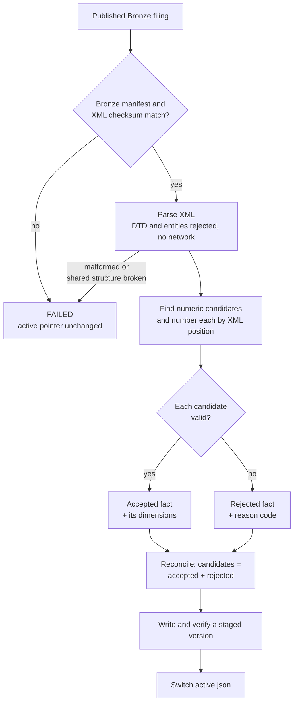
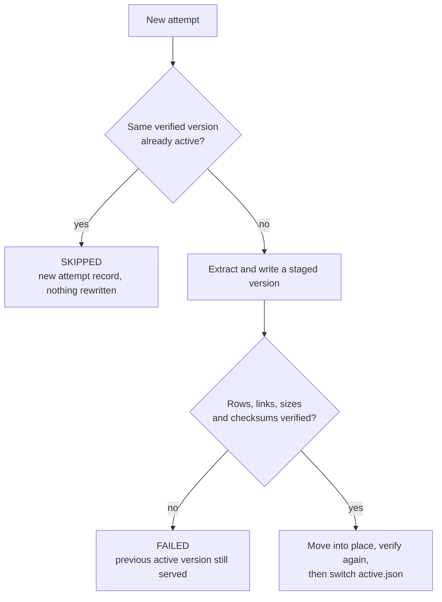

# Silver: extracting XBRL facts

## Purpose

Silver turns one verified XBRL instance from Bronze into typed Parquet files of numeric facts. It keeps fact **occurrences**, not answers: the same revenue concept can appear for a quarter, the year to date, a comparative year and a business segment, and Silver keeps every one of them with its context. Choosing which occurrence represents a company's revenue is Gold's job.

In the [20-company cohort](../validation/cohort.md), Silver published 400 active versions holding 601,103 accepted facts and 643,624 dimension rows.

## Goals and non-goals

Goals:

- Read only verified Bronze input.
- Keep every numeric candidate, either accepted or rejected with a reason. Nothing disappears silently.
- Store values exactly: no floats, no rounding, nil kept as null rather than zero.
- Give every fact a stable ID that survives reruns, so Gold can point back to it.
- Publish new output as a version, and switch readers to it only after it is verified.

Non-goals:

- Selecting, deduplicating or summing facts.
- Full XBRL coverage: non-numeric facts and unmarked company extensions are out of scope.
- Fetching anything from the network, including XML schemas or DTDs.

## Design



### Reading the input

Before parsing, Silver checks the canonical Bronze path, the manifest status, the discovery record and the single verified instance file, then reopens the XML and matches its size and SHA-256 to the manifest. A staged or modified file can't become input just because its name looks right.

The XML parser rejects DTDs and entity declarations after the encoding is known, so UTF-8 and UTF-16 files follow the same rule, and it never makes external requests. This came from a real bug: a UTF-16 file with a DTD got past an earlier check that searched the raw bytes.

### Finding numeric facts

A root-level element is a numeric candidate if it has a `unitRef`, `decimals` or `precision` attribute, even an empty one. A small set of known US-GAAP and DEI numeric concepts is also recognized by **namespace and name**, so one of those with a missing `unitRef` is rejected rather than skipped. A familiar name in a company's own namespace isn't enough: a company extension called `Assets` must not become US-GAAP `Assets`. Namespaces are tracked through units and typed dimensions, where a prefix can be redefined inside the document.

### Fact identity

Each occurrence gets a `source_occurrence_id`: a SHA-256 over the CIK, accession, document name, document SHA-256 and the element's position under the XML root. Each part is length-prefixed before hashing, so two different combinations can never produce the same input string.

The ID has no run ID and no value in it, so a rerun of the same document produces the same IDs. Positions are counted **before** deciding whether an element is accepted. If a parser change starts recognizing an element that used to be missed, every other fact keeps its ID.

### Item failures and filing failures

| Problem | Example | Result |
| --- | --- | --- |
| One fact is unusable | Missing unit, unknown context, value out of range | That fact is rejected with a reason; the rest of the filing is published |
| The shared structure is unusable | Malformed XML, a DTD, a broken context table, a partial parse | The whole extraction fails; nothing new is published |

A bad `contextRef` on one fact shouldn't erase the others. A broken context table could make every later result wrong, so Silver publishes nothing. Rejection reasons include `MISSING_UNIT_REF`, `CONTEXT_NOT_FOUND`, `UNIT_NOT_FOUND`, `INVALID_PERIOD`, `INVALID_VALUE`, `NON_FINITE_VALUE` and `DECIMAL_OUT_OF_RANGE`.

### Exact values

Values go through Python `Decimal` and are stored as `DECIMAL(38,18)`. A value that can't fit exactly is rejected, never rounded or converted to a float. Nil is null, not zero. The raw text and the `decimals` and `precision` attributes are kept as written, because Gold checks them later.

A fact with no dimensions isn't automatically the company total, and Silver doesn't treat it as one. A 10-Q can report revenue of 130 for the quarter, 230 for six months year to date and 40 for one segment. Adding them, or keeping whichever appears last in the XML, would answer a different question. Silver keeps all three with their real contexts.

## Data

| File | One row per | Contents |
| --- | --- | --- |
| `facts.parquet` | Accepted numeric occurrence | Source identity, concept and namespace, context, entity, period, unit, raw value, exact value, accuracy attributes |
| `fact_dimensions.parquet` | Dimension on an accepted occurrence | Axis, explicit or typed member, and where in the context it appeared, joined by `source_occurrence_id` |
| `rejected_facts.parquet` | Rejected candidate | Its position, reason code and whatever raw evidence was readable |
| `runs/run_id=<id>.json` | Attempt | Status and counts, including failed and skipped attempts |

```text
<silver root>/cik=<CIK>/accession=<accession>/
├── active.json                     which version readers use
├── runs/run_id=<run-id>.json
└── versions/document=<XML>/source_sha256=<hash>/parser=<version>/schema=<version>/
    ├── facts.parquet
    ├── fact_dimensions.parquet
    ├── rejected_facts.parquet
    └── publication.json            counts, the Bronze manifest's SHA-256, and each file's rows, schema, size and SHA-256
```

## Versioning and the active pointer

A version is identified by the source document, its checksum, the parser revision and the row schema, not by the run that produced it. That makes the version path itself a record of what was parsed and how.



Before writing, Silver checks that accepted plus rejected equals candidates and that every dimension row points to an accepted fact. The version is verified in staging, moved into place with one rename on the same filesystem, and verified again before the pointer changes. Readers, including the catalog, follow `active.json` only; a directory under `versions/` has no effect until the pointer selects it. A matching but inactive version isn't promoted just because it exists. The one exception is recovery: if a previous attempt published a verified version and failed before switching the pointer, the next attempt can activate that same version after checking the earlier failure evidence.

| Status | Meaning |
| --- | --- |
| `COMPLETE` | Every candidate accepted, and at least one non-nil numeric fact |
| `PARTIAL` | Useful facts published, with identified rejections |
| `FAILED` | No new active version; any earlier active version stays in place |
| `SKIPPED` | An equivalent verified version is already active |

When the parser changes, its version number changes, so reprocessing a filing publishes a new version beside the old one and moves the pointer. Older versions stay as history, and the catalog reads only the active one. Two parser rules came from real bugs:

- **Count before you filter.** A fact without a unit was being skipped before the rejection logic ran, so a run reported success with zero rejections. Known US-GAAP and DEI numeric concepts without a `unitRef` are now rejected as `MISSING_UNIT_REF`.
- **Read the whole element.** A valid date followed by a nested element had been accepted. Nested elements or stray text inside a context's identifier or dates now make that fact invalid, for example `INVALID_PERIOD`.

## Failure handling

- An input check failure or a parse failure publishes nothing and leaves the active pointer where it was.
- A verification failure removes the staged files and records the reason in the run record; readers keep using the previous version.
- If writing the run record fails after the pointer moved, the switch isn't rolled back. The error is reported with the pointer as it actually is.
- Publication is local and single-writer. It isn't a transaction across filesystems and isn't protected against power loss.

## Trade-offs and limits

| Choice | Cost |
| --- | --- |
| Keep every occurrence instead of deduplicating | Gold has to do the selection, and Silver is larger. In return, Gold can tell agreeing duplicates from real conflicts |
| Numeric candidates are identified by attributes plus a known-concept list | An unmarked company extension can be missed |
| Exact `DECIMAL(38,18)` | Values beyond that range are rejected instead of approximated |
| Immutable versions | Disk space grows with each parser revision; the catalog only reads active ones |

See [decision 4](../decisions/engineering-decisions.md#4-silver-keeps-every-fact-with-exact-values-and-explicit-rejections) and [decision 5](../decisions/engineering-decisions.md#5-silver-is-versioned-and-an-active-pointer-decides-what-readers-see).

## Code and tests

| Part | Code |
| --- | --- |
| Input checks and parsing | [`silver_extraction.py`](../../src/sec_edgar_lakehouse/silver/silver_extraction.py) |
| Fact, dimension and rejection records | [`silver_models.py`](../../src/sec_edgar_lakehouse/silver/silver_models.py) |
| Typed Parquet writing and rechecks | [`silver_parquet.py`](../../src/sec_edgar_lakehouse/silver/silver_parquet.py) |
| Versions, activation and recovery | [`silver_publication.py`](../../src/sec_edgar_lakehouse/silver/silver_publication.py) |

The [Silver tests](../../tests/silver/) cover malformed XML, a UTF-16 file with a DTD, context errors, exact decimals, versioning and pointer regressions. The [Apple and Microsoft run](../validation/multi-company-acceptance.md) checked active pointers, version files and fact ownership across 4,265 accepted facts, and a Microsoft rerun left the earlier versions and pointers byte-for-byte unchanged.
